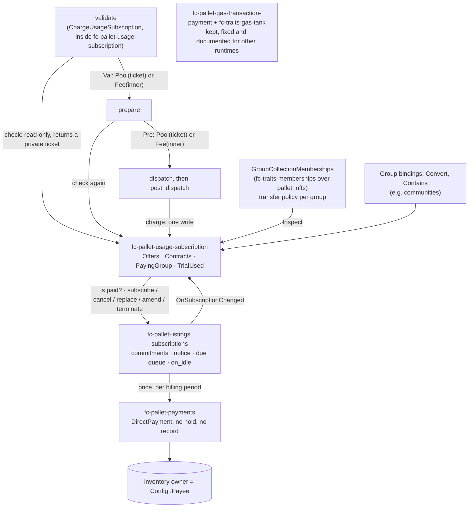

# Usage subscriptions — Implementation Plan (frame-contrib)

> **This is the frame-contrib part of the usage-subscriptions plan, `PLAN.md` v0.10.0.** It keeps every decision,
> binding, test and milestone that concerns frame-contrib's crates, and leaves out what binds one runtime: that
> runtime's facts and live state (§1.3, §1.5), its wiring (§4.5, §4.6), its migrations (§6.2–§6.5), its milestone
> `M-3` and features (`F-00`, `F-07a`, `F-07b`, `F-08`, `F-09`, `F-10`, `F-12`), its dependencies (§9) and the
> transition from its current chain (§12). Decisions that only bind one runtime are listed by identifier, so numbering
> stays stable. Identifiers such as `0002-A15` name the owner's review rulings (amendments), which are recorded with
> the specification's working documents. `SPEC.md`, beside this file, is the normative specification; where they
> disagree, `SPEC.md` wins.

# Usage subscriptions — Implementation Plan

This plan says **how**. `SPEC.md` says what. If they disagree, `SPEC.md` wins, and the fix is an amendment in
`amendments/` first. Every feature, decision and milestone here traces to a `US`, `REQ`, `CTR`, `INV` or `NFR`.
Amendment 0001 (the owner's review) renamed the system, ruled the first blocking questions, and redesigned
memberships around the group that owns them. Amendment 0002 (the second review) ruled the rest, made trial
conversion opt-in and custom amendments unilateral with safeguards, kept the gas-tank payment step (fixed and
documented) beside a new one inside `fc-pallet-usage-subscription`, and moved every value out of this plan.
Amendment 0003 (the third review) closed the last open questions, replaced grandfathering with a one-time deposit
reallocation, moved `UsageSubscription` to index 17, protected billing across migrations, allowed offer-level
amendments, and made `SPEC.md` purely normative. Amendment 0004 replaced the targeted call filter with the
memberships manager owning every membership collection (`DEC-36`); `SPEC.md` did not change. Amendment 0005 closed
the remaining plan-level rulings: the reallocation's last 26 amounts, the track's values, the collective's members,
and `ListingsCatalog`'s force origin (`DEC-37`). Amendment 0006 confirmed `DEC-12`, `DEC-17`, `DEC-22`, `DEC-34` and

**v0.10.0 (R-1, 2026-10-15).** Amendment 0009 recorded what the `M-1` implementation found; its rulings bound the
paying-group lookup in reads (`DEC-7`), find memberships by id through an index (`DEC-17`), make listings' merchant
powers opt-in per item (`DEC-22`), retry a failed charge once before its grace ends (`DEC-6`), and name in §4.1 and
§4.2 what landed. Amendment 0011 caps the allowance sold against a declared, schedulable capacity (`DEC-39`–`DEC-44`,
`F-13`). `SPEC.md` v0.5.1 carries the normative half (`REQ-CT-7`, `REQ-SB-11`, `INV-6`, `AC-C3.2`, `CTR-SUB-2`, and, from
0012-A4, the capacity cap `REQ-CP-1`–`REQ-CP-6`).

**This plan is the home of every technical decision** (0003-A7). `SPEC.md` holds only normative requirements, and
each deployment's documents hold its values. A technical decision found anywhere else is moved here, with a pointer
left behind.

**This plan names `Config` items and gives no values.** Each deployment chooses its own values (0002-A8).

## 0. How to read this document

| Prefix | Meaning |
|---|---|
| `DEC-*` | A technical decision: what, the alternatives, why, the cost, and how reversible it is |
| `F-*` | A feature: a bounded unit of work. Its exit criterion names spec identifiers |
| `M-*` | A milestone: features that together make a claim true |
| `RISK-*` | A risk, with its mitigation |
| `DEP-*` | Something we are waiting on (an owner ruling, or the state of a branch), and what we plan in the meantime |

Identifiers follow the spec's rule: never renumbered; a withdrawn one stays with a note.

Source references are `repo@ref:path:line`.

| Short | Means |
|---|---|
| `fc2` | `virto-network/frame-contrib` `release/v2` at `6d4a6f8` (2.3.1) |
| `fc3` | `main` at `f95b25e` (3.0.0-pre.2) |
| `nfts43` | `pallet-nfts` 43.0.0 (crates.io source) |
| `fcm` | `fc-traits-memberships` 2.3.1 (crates.io source, identical to `fc2:traits/memberships`) |
| `tp49`, `fs48`, `fsup48`, `sw36`, `ref49`, `sr48` | `pallet-transaction-payment` 49.0.0, `frame-system` 48.0.0, `frame-support` 48.1.0, `sp-weights` 36.0.0, `pallet-referenda` 49.0.0, `sp-runtime` 48.0.0: the crates.io versions of polkadot-sdk stable2606 |

---

## 1. Ground truth: what exists today

### 1.1 The per-membership gas tank, and why it breaks

Every defect below that lives in frame-contrib is fixed in place by `DEC-23` (0002-A15). The crates stay.

| Fact | Where |
|---|---|
| `GasBurner { check_available_gas(who, estimated) -> Option<Gas>; burn_gas(who, expected, used) -> Gas }`. Plus `GasFueler`, `GasTank`, `MakeTank` | `fc2:traits/gas-tank/src/lib.rs:11-56` |
| `NonFungibleGasTank` keeps a `WeightTank` in the item attribute `membership_gas`, and a pre-dispatch note in `mbmshp_pays_gas` | `fc2:traits/gas-tank/src/impl_nonfungibles.rs:19-20, 22-28` |
| **Reset bug.** `if now - since > period { since = now + period; … put }`. This runs inside `check_available_gas`, so it writes during validation | `…/impl_nonfungibles.rs:105-109` |
| Validation also writes the `mbmshp_pays_gas` note | `…/impl_nonfungibles.rs:111-118` |
| `F::owned(who).find_map(...)` walks every item the account owns. It is unbounded, in validation | `…/impl_nonfungibles.rs:91` |
| The extension calls `check_available_gas` in `validate` **and again** in `prepare`. When `prepare` finds none, it calls the inner `prepare` with `val.expect("value was given on validate; qed")`, which panics because validation took the gas path and never ran the inner `validate` | `fc2:pallets/gas-transaction-payment/src/extensions.rs:97-111, 143-157` (expect at `:150`) |
| **Accounting bug.** `post_dispatch_details` returns `used_gas` as *unspent* weight, so `post_info.refund(used_gas)` takes the call's whole weight off the extrinsic's recorded weight | `extensions.rs:184-190`. Refund semantics: `frame-support-48.1.0:src/dispatch.rs:617-621`, and `sp-runtime-48.0.0:src/traits/transaction_extension/mod.rs:399-410` |
| **Estimate/charge mismatch.** It admits on `info.call_weight`, but burns `post_info.actual_weight`. That value already includes every extension's weight, because `set_extension_weight` runs before `post_dispatch` | `extensions.rs:97, 184`. `sp-runtime-48.0.0:src/traits/transaction_extension/dispatch_transaction.rs:159-160` |
| The extension's `weight()` is the gas path's benchmark only. It never adds the inner extension's weight | `extensions.rs:77-79` |
| The wrapper is invisible in metadata (`TypeInfo` and `IDENTIFIER` are the inner extension's). Changing its behaviour is not client-visible | `extensions.rs:15-23, 72` |
| **Leftover attributes.** `release` burns the item without clearing its attributes. | `fcm:src/impl_nonfungibles.rs:143-155` |

### 1.2 Listings, orders and payments: the recurring-payments verdict

**Verdict: partial in design, missing in implementation.**

| What | State | Where |
|---|---|---|
| Subscription traits (`InspectSubscription`, `MutateSubscription`), `SubscriptionConditions { price, period }`, `Subscription { price, next_renewal }`, termination and dispute types | **Declared only.** `SubscriptionConditions` and `Subscription` derive nothing. `activate`/`cancel`/`terminate` take no subscriber. `publish<Reason>` takes its `name` as `Reason`. Byte-identical on `fc3` | `fc2:traits/listings/src/item.rs:180-366` (no derives `:184-192`). Re-exported at `lib.rs:23` |
| `fc-pallet-listings` | Implements inventory and item traits only. **No** subscription implementation, storage, calls, scheduler or hooks | `fc2:pallets/listings/src/impls.rs:10-189`. Calls: `lib.rs:257-525` |
| `fc-pallet-orders` | One-off carts. Nothing recurring | `fc2:pallets/orders/src/types.rs:49-69` |
| `fc-pallet-payments` | An escrow per payment. Nothing recurring | `fc2:pallets/payments/src/impls.rs:51-99`, `types.rs:56-68` |
| Assets | Listings, orders and payments price only in `pallet_assets` assets (`FungibleAssetLocation`). A runtime's native `Balances` is not priced directly | — |

So Epic E is new work in `fc-traits-listings` and `fc-pallet-listings` (`F-02`).

### 1.4 Memberships today

| Fact | Where |
|---|---|
| `Inspect<AccountId>`: `Group`, `Membership`, `user_memberships(who, maybe_group) -> Box<dyn Iterator>`, `is_member_of` (default: `user_memberships(who, Some(g)).next().is_some()`), `check_membership(who, m) -> Option<Group>`, `members_total(g)` | `fcm:src/lib.rs:24-46` |
| `InspectEnumerable`: `group_available_memberships(g)`, `memberships_of(who, maybe_g)`. `Manager`: `assign(g, m, who)`, `release(g, m)`. `Rank`: `rank_of`, `set_rank`, `ranks_total` | `fcm:src/lib.rs:48-119` |
| `NonFungiblesMemberships`: `Group = CollectionId`, `Membership = ItemId`. `user_memberships(who, Some(g))` is `owned_in_collection(g, who)`; with `None` it is `owned(who)`. Both are lazy `KeyPrefixIterator`s, one read per `next()` | `fcm:src/impl_nonfungibles.rs:28-37`; `nfts43:src/impl_nonfungibles.rs:471-507` |
| `check_membership` scans every item the account owns | `fcm:src/impl_nonfungibles.rs:39-41` |
| **Assign** transfers the manager item (collection 0) to `ASSIGNED_MEMBERSHIPS_ACCOUNT` and mints a twin with the same id in the group's collection. **Release** sets rank 0, burns the twin, and transfers the manager item back to the group's owner | `fcm:src/impl_nonfungibles.rs:14, 129-155` |
| Stock is "items of collection 0 owned by the group's collection owner" | `fcm:src/impl_nonfungibles.rs:56-66` |
| `add_member` takes the **first item the community account owns in any collection**, not via `group_available_memberships` | `fc2:pallets/communities/src/lib.rs:425-440` |
| `remove_member(who, membership_id)` checks that `who` is a member of the community, but **not** that `who` holds `membership_id` | `fc2:pallets/communities/src/lib.rs:448-465` |
| `vote`/`remove_vote` resolve the community from the membership id alone (`check_membership`); votes are keyed `(poll, membership_id)` | `fc2:pallets/communities/src/lib.rs:532-580`, `functions.rs:75-140` |
| `pallet_nfts::do_transfer` refuses if `Locker` locks the item, if the `TransferDisabled` system attribute is set, if the collection has `TransferableItems` off, or if the item has `Transferable` off. `do_burn` checks the first two. Every check applies to trait-level transfers and burns too | `nfts43:src/features/transfer.rs:59-80`, `features/create_delete_item.rs:208-217` |
| `Transfer::disable_transfer`/`enable_transfer` set and clear the `TransferDisabled` system attribute (`Pallet` namespace, which no signed caller can clear) | `nfts43:src/impl_nonfungibles.rs:412-444` |
| `burn` keeps attributes. `Mutate::clear_attribute` works on a burnt item and decrements the collection's attribute count | `nfts43:src/features/create_delete_item.rs:208-269`, `features/attributes.rs:285-345`, `impl_nonfungibles.rs:353` |
| `lock_collection` disables collection settings for good ("it's possible only to lock the setting, but not to unlock it after"). Community accounts own and administer their collections, so a group admin can do this today | `nfts43:src/features/lock.rs:24-50` |

## 2. Shape of the solution



| Crate | Line | Change | Bump (owner's rule: breaking = client-visible) |
|---|---|---|---|
| `fc-traits-gas-tank` | 2.x, 3.x | **Kept and fixed** (`DEC-23`): `NonFungibleGasTank` writes nothing in its check, computes its window, and bounds its scan. `GasBurner` gains two provided methods (*reworded by 0009-A13*). Integration guide (`F-11`) | Minor (2.4.0). Additive only |
| `fc-pallet-gas-transaction-payment` | 2.x, 3.x | **Kept and fixed** (`DEC-23`): the decision travels in `Val`, `PathMismatch` instead of the panic, metered estimate, correct unspent weight, declared weight covers the inner extension. Integration guide (`F-11`) | Patch-eligible (no API or metadata change); ships with 2.4.0 unless the owner wants 2.3.2 |
| `fc-traits-listings` | 2.x, 3.x | Real subscription types and traits: subscriber, term limit, minimum commitment, *Defaulted*, amendment, replacement, zero price, hooks | Minor. Nobody implements them today |
| `fc-pallet-listings` | 2.x, 3.x | Subscriptions: storage, calls 8–19 (0009-A4, A17, A20.6), due queue, `on_idle`, events. New `Config` items | Minor (additive) |
| `fc-traits-payments`, `fc-pallet-payments` | 2.x, 3.x | New `DirectPayment` trait and its implementation: a direct payment, no hold, no stored record, one event (`DEC-5`) | Minor (additive) |
| `fc-traits-memberships` | 2.x, 3.x | New `GroupCollectionMemberships` implementation, `memberships::Transfer` trait and per-group transfer policy (`DEC-17`, `DEC-26`), a read-bounded enumeration (`DEC-7`, 0009-A1) and an index from membership id to group (`DEC-17`, 0009-A19.3). `NonFungiblesMemberships` deprecated in 2.4.0, removed in 3.x | Minor (additive in 2.x) |
| `fc-pallet-communities` | 2.x, 3.x | `add_member` takes from the group's stock; `remove_member` checks the holder; new calls 12 `transfer_membership` and 13 `set_transfer_policy`; public `community_state` | Minor (additive calls); breaking `Config` changes, see below |
| **`fc-pallet-usage-subscription`** | 2.x, 3.x | New pallet, with its own payment-step `TransactionExtension` (`DEC-24`), its guide, and an opt-in cap on the allowance sold (`DEC-39`–`DEC-44`, 0011) | Minor (new pallet) |

**Breaking changes in 2.4.0** (a runtime must act on each; *added by the owner-proxy review round*):
- `fc-pallet-usage-subscription` has no `Config::PayingGroupChangeWindow`: the rate window is `MinUsagePeriod`
  (`REQ-PC-5`, `DEC-21`; #130 m-1).
- `fc-pallet-communities` `Config` gains a required `MemberOrigin` (`DEC-31`), and `MemberMgmt` is bounded by
  `InspectEnumerable` + `memberships::Transfer` (#126 m2).
- `NonFungiblesMemberships` has no grace period: a runtime switches to `GroupCollectionMemberships` with a data
  migration at the upgrade (`DEC-17`; #126 m2).

---
## 3. Decisions

**`DEC-1` One new pallet in frame-contrib, generic over a group.**
*Decision:* `fc-pallet-usage-subscription` (`pallets/usage-subscription`, runtime alias `UsageSubscription`) lands
in frame-contrib `release/v2` first. It holds offers, contracts, paying-group choices and the trial register, and it
carries its own payment-step extension (`DEC-24`; *reworded by 0002-A15*: it no longer implements `GasBurner`). It
knows groups only through `fc_traits_memberships::Inspect<AccountId>` plus two bindings,
`GroupAccount: Convert<Group, AccountId>` and `UsableGroup: Contains<Group>` (`REQ-GR-1`–`REQ-GR-3`), and billing
only through the subscription traits. *Alternatives:* a bespoke `MembershipFacts` trait (v0.1; withdrawn by 0001-A6);
a pallet inside one runtime's own tree. *Why:* frame-contrib stays chain-agnostic. It also makes the
pallet testable in a mock runtime with no communities. *Cost:* two one-line runtime bindings. *Reversibility:* high.
Traces: Epics A–D, `CTR-CALL`, `CTR-QRY`, `CTR-EVT`, `CTR-MEM`.

**`DEC-2` Admission is read-only and ticketed: reshape `GasBurner`.** *Withdrawn by 0002-A15.*
Was: reshape `fc-traits-gas-tank`'s `GasBurner` around a ticket (`check_available_gas(who, estimated) ->
Option<Ticket>`, `burn_gas(ticket, used)`), and rebuild `fc-pallet-gas-transaction-payment` around it. The owner
ruled that the gas crates stay and are fixed in place (`DEC-23`), and that usage subscriptions get their own
extension. The ticket design survives, private, inside `fc-pallet-usage-subscription` (`DEC-24`).

**`DEC-3` Usage windows are computed, not reset.**
*Decision:* a contract stores `anchor`, `usage_period`, `window_start` and `used`. The current window start is
`anchor + ((now − anchor) / U) · U`, and `used` counts only if the stored `window_start` equals it. The
extension's post-dispatch charge is the only writer: it sets `window_start` and `used` in one `mutate`. An amended
allowance is stored with the window start it applies from (the first window starting at or after the amendment's
effective boundary, `DEC-28`), and admission reads
whichever allowance applies to the current window (`REQ-CT-8`). All arithmetic is `checked_*` or `saturating_*`.
Usage storage is constant per contract: one `window_start` and one `used`, overwritten when a new window begins; no
history of past windows is kept. A contract has at most one pending allowance: in its single `pending` slot (custom
contracts) or in its offer's single `OfferAmendment` record (standard contracts, `DEC-34`), never both. *Sentence added
by 0006-A3.* A further amendment of a contract is refused with `ERR-ChangePending` while an earlier amended allowance
waits for its window (`next_allowance`), so a contract never holds two future allowances; it may wait up to one usage
period (*ruled by 0009-A20.4*).
*Why:* `INV-5` by construction; admission stays read-only (`INV-1`). *Reversibility:* high.
Traces: `REQ-PL-1`–`REQ-PL-5`, `INV-4`, `INV-5`, `INV-14`.

**`DEC-4` Billing is Listings subscriptions. Offers are subscription items.**
*Decision:* an offer is a listings item in the collective's inventory, with `SubscriptionConditions` (price, billing
period, term limit, minimum commitment, grace). Its weight terms and kind live in `UsageSubscription::Offers`. A
contract is the listings subscription keyed `(inventory, item, subscriber = group account)`, plus
`UsageSubscription::Contracts[group]`, which copies the weight terms (`INV-9`). Kind rules (standard open-ended,
trial limited and once per group, custom single-use) are enforced by `fc-pallet-usage-subscription` before it calls
`subscribe`. *Why:* the recurring machinery is generic. *Cost:* two pallets share one lifecycle through hooks
(`OnSubscriptionChanged`). *Reversibility:* medium.
Traces: Epic E, `REQ-OF-*`, `REQ-CT-*`, `REQ-BL-*`, `REQ-SB-*`.

**`DEC-5` Recurrence lives in listings; each charge is a direct payment through `fc-pallet-payments`.** *Reworked
by 0002-A20* (was: a plain transfer, outside payments).
*Checked:* `fc-pallet-payments` has no recurring charges, on `release/v2` or on `main`, and no branch, issue or PR
covers them. It does have a non-escrow path: `request_payment` then `accept_and_pay` transfers the amount directly
and settles fees through `FeeHandler` (`fc2:pallets/payments/src/lib.rs:360-436, 523-546`). The trait-level
`fc_traits_payments::Mutate::create` holds funds (`fc2:pallets/payments/src/impls.rs:51-90`, through
`reserve_payment_amount`), so it is not that path. Finished payments are never removed from storage; only a
cancellation removes a record (`lib.rs:463-464`).
*Decision:*
- Listings subscriptions own the recurrence (`DEC-6`). Each period's charge calls a new, additive trait
  `fc_traits_payments::DirectPayment<AccountId>: Inspect<AccountId>` with one method, `pay(sender, asset, amount,
  beneficiary, details) -> Result<Id, DispatchError>`.
- `fc-pallet-payments` implements it with `accept_and_pay`'s steps in one call: `FeeHandler::apply_fees`, the
  sender's fees, the amount transferred with `Preservation::Preserve` (never held), the beneficiary's fees,
  `OnPaymentStatusChanged::{on_payment_charge_success, on_payment_released}`, and an event `PaymentDirect { id,
  sender, beneficiary, asset, amount, fees }`. It keeps no `Payment` record, so recurring charges do not grow storage.
  Additive: a new trait, a new event, no change to existing calls or storage (minor).
- A zero price makes no payment (`REQ-BL-7`). A failed payment moves nothing (`REQ-BL-5`): `pay` runs inside its own
  storage layer, so this holds whatever the caller (*confirmed by 0009-A19.1*, reversing a removal of 2026-10-01).
- A runtime binds listings' `Payments = Payments`, and may bind payments' `Assets` and `AssetsHold` to a union of its
  native currency and its assets (`UnionOf<Balances, Assets, …>` and `UnionOf<Balances, AssetsHolder, …>`; `UnionOf`
  implements `fungibles::Mutate` and `MutateHold`, `fsup48:src/traits/tokens/fungible/union_of.rs:513-612`), so
  native-currency charges go through payments.
- **Fees.** A runtime's `FeeHandler` should charge no fee on either side when the beneficiary is the configured
  payee. So a charge moves exactly the price (`REQ-BL-3`).
*Alternatives:* a plain transfer outside payments (the v0.2 choice; the owner wants charges tied to the payments
system); `Mutate::create` and `release` each period (an escrow hold and two steps, for no protection a prepaid
subscription needs). *Cost:* a new trait and a fee-handler rule; payments' asset binding widens to the native currency for every
payment. *Reversibility:* high.
Traces: `REQ-BL-3`, `REQ-BL-5`, `REQ-BL-7`, `INV-10`.

**`DEC-6` Due charges: a bucketed queue, processed in `on_idle`, with lead.** *Confirmed by the owner (0002-A21).*
*Decision:* each live subscription sits in `DueQueue[bucket(due − lead)]`, with buckets of `DueBucketSize` ticks.
A due tick at which a pending amendment takes effect is queued at `bucket(due)`, with no lead (`REQ-CT-14`).
A *Defaulted* subscription sits in the bucket of its commitment end, where `on_idle` ends and removes it
(`REQ-CT-12`). `on_idle` walks buckets ≤ the current one from a cursor, processing at most `MaxChargesPerBlock`
entries and weighing every empty bucket read. `charge_due` is permissionless (`REQ-BL-4`). Pool usability never
depends on the queue (`REQ-CT-4`), and a *Defaulted* record past its commitment end never blocks a subscription
(`REQ-CT-12`), so a late queue can only delay bookkeeping. *Extended by 0009 (R-1):*
- **Overflow.** A full bucket never drops or refuses a record: the entry overflows into `DueOverflow` and is processed
  with its bucket, so a hook never strands a live record and `subscribe` is never refused for queue capacity
  (0009-A4, A19.2).
- **Constraints.** `integrity_test` asserts `DueBucketSize ≤ RenewalLead`: a bucket can be processed up to
  `DueBucketSize − 1` ticks late, so a renewal queued at its lead tick is processed before its due tick only if the
  bucket is no longer than the lead (0009-A5). A billing period must be longer than `RenewalLead`, so that a charge's
  lead falls inside the period it pays for; a consumer that bounds billing periods from below
  (`MinBillingPeriod`) sets that bound above `RenewalLead` (0009-A11).
- **One retry before the grace end.** A suspended entry is queued at its grace end − `DueBucketSize`, where the queue
  attempts the charge once more, and then at its grace end, where it lapses or defaults. One extra queue entry per
  suspension; a group that tops up is restored without anyone calling `charge_due` (*ruled by 0009-A20.1c*). The
  subscription record carries `retry_pending`, and no retry is queued when that bucket is not after the current one
  (ruling 0009-a20.1c).
- **Hooks' weight.** Every processed entry, and every call that can notify, adds
  `OnSubscriptionChanged::max_hook_weight()` to its weight (0009-A16; §4.2, §7).

*Alternatives:* `on_initialize` (mandatory weight in every bundled block) or `pallet_scheduler` (one agenda per
subscription per period); for the retry, none (someone must call `charge_due` within grace) or one per bucket
through grace (a queue entry per bucket per suspension). *Cost:* renewals can be late under sustained full blocks
(`RISK-3`). *Reversibility:* high.
Traces: `REQ-BL-4`, `REQ-SB-4`, `NFR-3`.

**`DEC-7` Paying group: a stored choice, else the only group** (`OQ-1` resolved by 0001-A9). *Decision:*
`UsageSubscription::PayingGroup[account]`, set by `set_paying_group` (`DEC-21`). On a miss, the pallet reads
`T::Memberships::user_memberships_bounded(who, MaxMembershipScan + 1)`, a provided method of
`fc_traits_memberships::Inspect` that stops after that many storage reads, counting the items it skips (*reworded by
0009-A1*; was `user_memberships(who, None).take(MaxMembershipScan + 1)`, which bounded the items returned, not the items
read). If it reads at most `MaxMembershipScan` items and those it returns are all of one group, that group is the
answer. Anything else, including hitting the bound, means none (`REQ-PC-2`, `REQ-PC-3`). So a group account that signs,
and holds stock, takes the fee path instead of reading its whole stock. The group account never appears, because
`GroupCollectionMemberships` excludes a collection's owner from its own memberships (`DEC-17`). *Why:* bounded
(`NFR-1`), and it never guesses. *Reversibility:* high.

**`DEC-8` The collective is listings merchant 0, and the configured payee owns its inventory.** *Reworked by
0001-A8, and again by 0002-A2 and 0002-A11.*
*Decision:* `fc-pallet-usage-subscription` lazily creates inventory `(CollectiveMerchant, USAGE_INVENTORY)`, owned by
`T::Payee::get()`, on the first `publish_offer`, so every charge goes to the configured payee (`DEC-5`). A runtime
sets `CollectiveMerchant` to the merchant that stands for the collective (0002-A11), and `Payee` to the account that
receives every charge. The runtime's listings `SubscribeOrigin` refuses that merchant, so usage contracts only go
through `UsageSubscription::subscribe`. `UsableGroup` refuses the collective's own group (`REQ-GR-4`). *Cost:* none beyond the `SubscribeOrigin` and `UsableGroup` checks.
*Reversibility:* medium.

**`DEC-9` The fate of the old interfaces, per line.** *Reworded by 0002-A15: nothing in the gas crates is removed.*

| Line | `fc-traits-gas-tank`, `fc-pallet-gas-transaction-payment` | `fc-traits-memberships` |
|---|---|---|
| fc 2.3.2 (optional) | The extension's fixes 1–4 only (`DEC-23`), if the owner wants them before 2.4.0 | Unchanged |
| fc **2.4.0** | All of `DEC-23`: fixed in place, additive only. Integration guide (`F-11`) | `GroupCollectionMemberships`, `memberships::Transfer` and the transfer policy added. `NonFungiblesMemberships` and `ASSIGNED_MEMBERSHIPS_ACCOUNT` `#[deprecated]` |
| fc **3.x** (`main`) | Same fixes and guide, ported | `NonFungiblesMemberships` removed |

Release notes say so (`REQ-RT-3`).

**`DEC-17` The memberships manager owns items in the group's own collection.** *Confirmed by 0006-A1.* *Reworded by 0004-A1: the collection
owner is the manager account (`DEC-36`), so the group account comes from the group binding.*
*Decision:* add `GroupCollectionMemberships<NF, ItemConfig, GroupAccount, ManagerAccount>` to `fc-traits-memberships`,
where `GroupAccount: Convert<CollectionId, AccountId>` names the account that holds a group's stock and
`ManagerAccount: Get<AccountId>` the account that owns every collection, implementing `Inspect`,
`InspectEnumerable`, `Attributes`, `Manager`, `Rank` and a new trait:

```rust
/// Moves a membership between holders, as its group's policy allows (REQ-MI-9, REQ-MI-15).
pub trait Transfer<AccountId>: Manager<AccountId> {
    fn transfer_policy(group: &Self::Group) -> TransferPolicy;
    fn set_transfer_policy(group: &Self::Group, policy: TransferPolicy) -> Result<(), DispatchError>;
    fn transfer(group: &Self::Group, m: &Self::Membership, to: &AccountId) -> Result<(), DispatchError>;
}
```

| Method | Behaviour |
|---|---|
| `user_memberships(who, Some(g))` | Empty if `who` is `GroupAccount(g)` (`REQ-MI-13`); else `owned_in_collection(g, who)` |
| `user_memberships(who, None)` | `owned(who)`, skipping items of any collection c where `who == GroupAccount(c)` (no read: the binding is a conversion, `REQ-GR-2`) |
| `group_available_memberships(g)` | `owned_in_collection(g, GroupAccount(g))`: the stock |
| `assign(g, m, who)` | `m` must be in the stock. `enable_transfer`, `transfer` to `who`, `disable_transfer`. Rank 0. `member_total` + 1 |
| `release(g, m)` | The holder must not be the group account. Rank 0 (adjusting `rank_total`). Unlock, transfer to `GroupAccount(g)`, relock. `member_total` − 1 |
| `transfer(g, m, to)` | Reads `g`'s policy (`DEC-26`). *Disabled*: refuse. *Existing members*: `to` must hold a membership of `g`. *Any account*: any `to`. Never the group account. Rank 0 or kept, per the policy. Unlock, transfer, relock. Totals unchanged |

No collection 0, no twin, no `ASSIGNED_MEMBERSHIPS_ACCOUNT`.

*Added by 0009 (R-1):*
- **Memberships are found by id in O(1)** (*ruled by 0009-A19.3*). `GroupCollectionMemberships` keeps an index from
  membership id to group, in unhashed storage under its own prefix, written at issuance and removed at burn;
  `check_membership(who, m)` reads it and then the holder. The bounded scan and its `MaxCheckScan` parameter are
  withdrawn. `Issue::index(group, m)` lets a runtime migration index items that exist before it. The index is shared
  by every `GroupCollectionMemberships` instance in a runtime, so membership ids must be unique across them; the
  crate documents this (0009-A21).
- **Reads are bounded in items read** (0009-A1). `user_memberships_bounded(who, max_reads)` (`DEC-7`) counts the items
  it skips; its default is `user_memberships(who, None).take(max_reads)`.
- **Attributes** (*ruled by 0009-A2 and A20.3*). `set_membership_attribute` writes only keys from an allowlist the
  manager declares, and `release` clears those keys, so `REQ-MI-4`'s release clause holds as written. `Issue::burn`
  clears what the manager wrote; clearing the namespaces a holder or a delegate writes is the issuer's, at its
  burn.

*Alternative:* change `NonFungiblesMemberships` in place, which silently changes behaviour for every runtime on 2.4.0.
*Why:* additive in 2.x; a runtime switches at the upgrade that migrates its data. *Reversibility:* high.

**`DEC-18` Item-layer lock; no blanket call filter.** *Reworded by 0002-A23: the call filter is withdrawn.*
*Decision:* every membership item carries the `TransferDisabled` system attribute (`nfts43:src/impl_nonfungibles.rs:421-443`),
set at mint and after every manager move. `do_transfer` and `do_burn` refuse locked items (`nfts43:src/features/transfer.rs:63-66`,
`features/create_delete_item.rs:214-217`), so a holder, a delegate or a buyer cannot move or burn one; the manager
unlocks, acts and relocks within one call. **A runtime sets no filter on its memberships collection's calls.** 0001's
`BaseCallFilter`, which refused every such call for non-Root origins, is withdrawn: memberships are bound to their
community, the community issues and retires its stock, and members transfer under its policy, through origins of
their own (`DEC-31`). The audit of every `pallet_nfts` call found that what a member or any signed
account can still call is harmless under the lock; ten calls reachable by the community account, as its collection's
Owner, Admin, Issuer and Freezer, are not. *Closed by 0004-A1*: the community account holds no collection role any
more; the manager account does (`DEC-36`). *Alternatives:* the blanket filter (withdrawn by the owner); a targeted
filter (`DEC-32`, withdrawn by 0004-A1); `CollectionSetting::TransferableItems` off
(blocks the manager too, and cannot be undone); `ItemSetting::Transferable` (the Freezer could toggle it); a stateful
`Locker`. *Cost:* one attribute per item. *Reversibility:* high.

**`DEC-21` `set_paying_group` is feeless for members, rate-limited.**
*Decision:* call 6 `set_paying_group(Option<Group>)` carries `#[pallet::feeless_if(|origin, group| …)]`, true when
the signer holds a valid membership of the named group (or, for `None`, of the group it had named) and
`PayingGroup[who].changes < MaxPayingGroupChanges` in the current rate window (`now / MinUsagePeriod`: `REQ-PC-5` defines the window as the deployment's minimum
usage period, so the removed `Config::PayingGroupChangeWindow` was a second item that could hold only one value;
#130 m-1).
`SkipCheckIfFeeless` then skips the payment step entirely, so the call costs nothing and touches no pool.
`PayingGroup[who] = { group, window, changes }`. *Alternatives:* `Pays::No` declared on every call (a free spam
channel); a transaction-extension payload (refused by the owner). *Reversibility:* high.

**`DEC-22` Listings carries commitments, defaults, amendments and zero prices.** *Confirmed by 0006-A1.*
*Decision:* `SubscriptionConditions` gains `term: Option<u32>` and `min_commitment: Option<u32>`;
`SubscriptionState` gains `Defaulted { until }`; `Subscription` gains `pending_conditions`. A charge of zero skips
the transfer. `cancel` before the commitment end records the cancellation and keeps charging until it. A lapse before
the commitment end becomes `Defaulted`, queued at the commitment end (`DEC-6`). `amend(inv, item, who, conditions)`
stores `pending_conditions` with its `effective_at` (`DEC-28`), refused if the billing period changes; the due
tick at `effective_at` is charged with no lead; `cancel` while `pending_conditions` is set waives the commitment
and ends at `paid_through` (`REQ-SB-13`). `cancel_replacement(inv, item, who)` drops a scheduled replacement
(`REQ-SB-12`). Hooks gain `on_defaulted`, `on_amended` and `allow_replacement` (`DEC-27`). *Why:* the lifecycle is
money and time, so it belongs to the generic capability (SPEC §4.2). *Reversibility:* medium: the types freeze with
2.4.0. *Reworded by 0002-A1 and 0002-A14.*

*Extended by 0009 (R-1):*
- **Merchant powers are opt-in per item** (*ruled by 0009-A17*). Listings serves several systems, so an item carries
  a `SubscriptionPolicy { amendments: Disabled | WithNotice { periods }, terminable_by_merchant: bool }`, kept beside
  its conditions and copied into each subscription when it starts. Default: `Disabled`, not terminable. With
  `WithNotice { n }` (n ≥ 1) an amendment takes effect at the first billing boundary at least n billing periods after
  enactment (n = 1 is `REQ-CT-14`'s rule). `amend` and `amend_item` (calls 14 and 16) refuse an item whose policy is
  `Disabled` (`AmendmentsDisabled`); `terminate` (call 12) refuses one that is not terminable (`NotTerminable`).
  `fc-pallet-usage-subscription` sets `WithNotice { periods: 1 }` and terminable on every offer it publishes, so
  nothing changes for usage subscriptions (`REQ-SB-10`: "MAY amend", with at least one period of notice).
- **Zero prices** (*ruled by 0009-A19.2 and A22*). Listings' direct `subscribe` (call 9) and its replacement call
  (13) refuse an item priced at zero (`ZeroPriceDirectSubscription`), so the shared due queue cannot be flooded with
  free subscriptions; the trait's `subscribe` and replacement methods accept zero, for consumers that gate it (usage
  subscriptions keep trials free) (`REQ-SB-11`). A target the merchant reprices to zero after a replacement is
  scheduled still takes effect at the tick: accepted, since only the item's own merchant can cause it.
- **Cases the plan left silent** (*ruled on their defaults by 0009-A20.1*): an item amendment skips, for good, a
  subscription that has its own amendment pending or a different billing period, which keeps its own terms; a
  cancellation drops a pending replacement, and a replacement requested while a cancellation is pending is refused
  (`CancelPending`); one automatic retry during grace (`DEC-6`); the subscriptions of an archived inventory keep
  renewing, as a withdrawn offer's contracts do (`REQ-OF-3`).
- **Typed errors** (0009-A20.5). The trait exposes `SubscriptionError`, so a consumer maps a refusal by variant
  (`CTR-CALL-2`), not by error name.
- **A storage deposit per subscription** (*ruled by 0012-A1: q1, q1b, q1c, q1d*). Load and state on the due queue
  must cost locked capital, and self-dealing must not refund it (`REQ-SB-15`–`REQ-SB-18`).
  `Config::SubscriptionDeposit: Consideration<AccountId, Footprint>` (FRAME's `Consideration`) takes it as a hold under
  `HoldReason::SubscriptionDeposit`. A runtime binds `HoldConsideration` with a fixed price in the native currency;
  `()` means no deposit. `Pallet::subscription_footprint()` gives the footprint (the record's size is bounded, so the
  price needs no per-byte part). The ticket lives in the `Subscription` record. `subscribe` takes it after billing
  period 0 is charged, inside a storage layer, because the deposit can still fail then
  (`InsufficientFundsForDeposit`, also `SubscriptionError::InsufficientFundsForDeposit`). The ticket is dropped when
  the subscription ends, on every end path. A replacement moves the ticket to the new record, with no release and no
  new hold. A *Defaulted* subscription keeps it until it ends. The payer is the subscriber: on the trait path,
  whoever the consumer names. For usage subscriptions it is the group's account, for every offer kind, custom offers
  included (pending 0012-q1e).
- **End hooks** (*ruled by 0012-A1: q1c*). `OnSubscriptionChanged` gains `on_end_scheduled(inventory, item, who, at)`,
  fired when an *Active* subscription's end becomes known (a cancellation requested, a free exit taken, or the
  term's last period being charged, up to the renewal lead before it starts) and again if the end moves; and
  `on_end_unscheduled(inventory, item, who)`, fired when
  a replacement is scheduled or an amendment lengthens the term. A *Suspended* or *Defaulted* subscription keeps the
  last reported end. With the earlier hooks they let a runtime act early on a held deposit, for example start
  unbonding a staked one. Listings knows nothing about staking.

**`DEC-23` Keep the gas crates, and fix them in place.** *Added by 0002-A15.*
*Decision:* `fc-pallet-gas-transaction-payment` and `fc-traits-gas-tank` stay, `NonFungibleGasTank` included. Each
fc-side defect of §1.1 is fixed where it is:

| # | Fix | Where | Rust API |
|---|---|---|---|
| 1 | **Validation and preparation agree.** `Val = Option<S::Val>` keeps its type: `None` already means "the burner was chosen". `prepare` on `None` checks again and, if the burner no longer covers the transaction, returns `InvalidTransaction::Custom(PATH_MISMATCH)`. On `Some(v)` it prepares the inner extension with `v` and never asks the burner again. No `expect` | `fc2:pallets/gas-transaction-payment/src/extensions.rs:129-171` | Unchanged |
| 2 | **Unspent weight.** `post_dispatch_details` on the burner path returns `Weight::zero()` (the extension's own unspent weight, none measured), never `used_gas` | `extensions.rs:184-193` | Unchanged |
| 3 | **Estimate and charge measure the same thing**, as `CheckWeight` does (0002-A4): the estimate is `info.total_weight() + base_extrinsic`, plus `len` as proof size; the charge is `post_info.calc_actual_weight(info) + base_extrinsic`, plus `len`, capped at the estimate. The pool is charged the weight as the payment step sees it, never less than what the block books after an outer storage-weight reclaim (`REQ-PL-6`, 0012-A2) | `extensions.rs:97, 144, 184` | Unchanged; tanks drain by the full metered weight |
| 4 | **Declared weight** is `charge_transaction_payment() + self.0.weight(call)`, so it covers the fee path too. `WeightInfo` keeps its one function, re-benchmarked to cover check plus burn | `extensions.rs:77-79` | Unchanged |
| 5 | **`NonFungibleGasTank` writes nothing in its check.** The window start is computed, `since + ((now − since) / period) · period`, and `used` counts only inside it; `>` becomes `≥`. The paying-item note (which item pays, under a per-account key) is written in preparation, through a new provided method `GasBurner::prepare_gas(who, estimated)`, whose default calls `check_available_gas`, so every other implementor is unaffected. `burn_gas` reads the note in O(1), rolls that item's stored window and adds the usage, so the tank that admitted the transaction pays for it whatever dispatch did to the signer's items; a second provided method, `GasBurner::cancel_gas`, drops the note when the transaction pays no fee (*reworded by 0009-A13*). The scan takes at most `MaxScan` items, a new type parameter with a default | `fc2:traits/gas-tank/src/lib.rs:16-29`, `impl_nonfungibles.rs:74-149` | **Additive**: two provided trait methods and a defaulted type parameter |

*Version.* Fixes 1–4 change no public item. Fix 5 adds three items, all defaulted: a minor under SemVer and under the
owner's rule. So `F-01` ships in **2.4.0** and the next `3.0.0-pre.N`. If the owner wants the extension fixed sooner,
1–4 can go out alone as **2.3.2**. Nothing here is client-visible: the extension's metadata is the inner one
(`extensions.rs:15-23, 72`). *Known limit withdrawn by 0009-A13:* the burn reads the paying-item note, so a call that moves the item, or gives the
signer an earlier-sorting one, during dispatch no longer escapes its charge. Usage subscriptions use a ticket (`DEC-24`).
*Alternatives:* the ticket reshape (`DEC-2`, withdrawn by the owner); removal (refused by the owner).
*Reversibility:* high.

**`DEC-24` The usage-subscription payment step is a `TransactionExtension` inside `fc-pallet-usage-subscription`.**
*Added by 0002-A15; confirmed by 0003-A5.*
*Decision:* `pallet_usage_subscription::ChargeUsageSubscription<T, S>(pub S, PhantomData<T>)` wraps a generic inner
extension `S` (e.g. `ChargeAssetTxPayment`), which handles the fee path.

- `Val = Path<Ticket, S::Val>` and `Pre = Path<Ticket, S::Pre>`, where `enum Path<P, F> { Pool(P), Fee(F) }` and
  `Ticket = { who, group, membership, window_start, estimated }` is private to the crate. The membership is in it
  for `DEF-1`.
- `validate`: if the origin is signed, compute the estimate (`REQ-PL-6`: `total_weight + base_extrinsic`, plus `len`
  as proof size) and run the read-only check, in `REQ-PL-7`'s order, each step returning early: resolve the group
  (`DEC-7`), the membership (`user_memberships(who, Some(group)).next()`), `UsableGroup::contains`, the contract and
  its subscription's `paid_through`, then the window arithmetic. A ticket means `Pool(ticket)`, default priority, no
  inner validation. None means `Fee(inner.validate(…))` (`CTR-FEE-3`).
- `prepare` on `Pool(t)`: check again; `Some(t') == t` gives `Pre::Pool(t)`, anything else
  `InvalidTransaction::Custom(PATH_MISMATCH)` (`ERR-PathMismatch`, `CTR-FEE-4`). On `Fee(v)`: `inner.prepare(v, …)`.
  No `expect` anywhere.
- `post_dispatch_details` on `Pool(t)` with `Pays::Yes`: actual = `calc_actual_weight + base_extrinsic`, plus `len`,
  capped at `t.estimated`; one `Contracts::mutate`; event `UsageCharged { group, who, weight, remaining }`
  (`CTR-EVT-2`); return `Weight::zero()` (`CTR-FEE-5`, `INV-11`). On `Fee(p)`: the inner one.
- `weight()` = max(`pool_path`, `fee_path_check` + `self.0.weight(call)`) (`CTR-FEE-6`).
- **Refunds** (#130 M-1, m-3). On both paths the extension's own unspent weight, the declared weight less what the
  taken path used (`CTR-FEE-5`), is refunded on a copy of `post_info` before the inner extension computes its fee
  (fee path) and before the pool is charged (pool path), so the signer's fee and the pool charge both exclude it.
  The fee path refunds by where the check stopped: no paying group, or no contract, refund the rest of
  `fee_path_check` (#130 m-3).
- **`SkipCheckIfFeeless` is required** around the extension (`REQ-PC-5`, #130 m-2; `DEC-21`).
- **Transparent in metadata, verified achievable:** `IDENTIFIER = S::IDENTIFIER`, `Implicit = S::Implicit`,
  `TypeInfo` with `Identity = S` returning `S::type_info()`, and `metadata()` forwarding `S::metadata()`, as the gas
  wrapper does (`fc2:pallets/gas-transaction-payment/src/extensions.rs:15-23, 72`). The default `metadata()` builds
  its entry from `IDENTIFIER` and the type's `TypeInfo` (`sr48:src/traits/transaction_extension/mod.rs:260-266`), and
  the derived codec of a newtype with `PhantomData` is the inner value's. So the transaction encoding does not change
  for clients. A test asserts that the runtime's metadata and an extrinsic's bytes are identical with either wrapper.

*Alternatives:* a separate crate, `fc-pallet-usage-subscription-transaction-payment` (two crates, two `WeightInfo`s,
and a public trait between them to carry the ticket); reusing the gas wrapper with a `GasBurner` implementation (needs
the reshape the owner withdrew, and makes the ticket public). *Why inside:* one crate, one `WeightInfo`, a private
ticket, no public surface to misuse. *Cost:* the pallet depends on `TransactionExtension` machinery. *Reversibility:*
high.

**`DEC-26` The transfer policy is a system attribute on the group's collection.** *Added by 0002-A13; confirmed by
0003-A5.*
*Decision:* `fc-traits-memberships` defines `TransferPolicy { receivers: Disabled | ToExistingMembers | ToAnyAccount,
rank: Reset | Keep }`, `Default` = `Disabled` with `Reset`. `GroupCollectionMemberships` stores a group's policy as
one `Pallet`-namespace system attribute (`membership_transfer_policy`) on the group's collection; an absent attribute
reads as the default. `transfer` reads it once. `fc-pallet-communities` adds call 13 `set_transfer_policy(policy)`,
`AdminOrigin`, event `TransferPolicySet`. *Cost:* one storage item per group that sets a policy, and one read per
transfer. *Alternatives:* a map in `fc-pallet-communities` (communities only; spaces would need their own); a field
in `fc-pallet-usage-subscription` (the wrong owner). *Why:* the manager is the only path that moves memberships
(`DEC-18`), and storing the policy on the collection keeps it generic over groups. *Reversibility:* high.

**`DEC-27` A trial's conversion is a replacement scheduled at subscription.** *Added by 0002-A1.*
*Decision:* `subscribe(offer, converts_into: Option<OfferId>)`. For a trial with `Some(target)`, the pallet checks
that the target is open, not a trial, and eligible (`ERR-InvalidConversion`), then calls
`schedule_replacement_at_term_end(inv, trial_item, group_account, target_item)` and records `pending: Convert(target)`.
A trial has no commitment, so a replacement placed at the first due tick at or after the commitment end would take
effect at the trial's second period; this one waits for the term limit's end (`CTR-SUB-2`, `REQ-CT-13`; *ruled by
0009-A7*). At the
trial's end, listings asks `OnSubscriptionChanged::allow_replacement`, which `fc-pallet-usage-subscription` answers
from the target's current status and the group's eligibility; a refusal, or a failed first charge, drops the
replacement, the trial completes, and the pallet emits `ConversionDropped { reason }`. On success, `on_replaced`
copies the target's terms into the new contract, and the event's end reason is *converted*. `cancel_switch()` (call 8)
calls listings' `cancel_replacement`.

*Why `Option<OfferId>`, not `Option<Box<ContractKind>>`:*
1. A recursive, boxed type has no `MaxEncodedLen`, so it cannot be stored in bounded storage (`NFR-5`).
2. The target must be an existing offer the group is eligible for, checked at subscription and again at the trial's
   end; an id names one, and a kind does not.
3. Its terms are copied at conversion, as every contract copies its offer's terms when it starts (`INV-9`); embedding
   terms in the trial would freeze them too early.

*Reversibility:* high.

**`DEC-28` A dedicated amend origin and track, a notice period and a free exit.** *Added by 0002-A14.*
*Decision:*
- `fc-pallet-usage-subscription` `Config` gains `AmendOrigin: EnsureOrigin`. `amend_contract` accepts only it.
- A runtime adds a custom origin variant (e.g. `UsageSubscriptionAmender`) and a referenda track, "Usage
  Subscription Amendments", routed from it in `track_for`. `AmendOrigin = EitherOf<EnsureRoot,
  UsageSubscriptionAmender>`. *Track structure, 0003-A2* (values in the deployment's own document):
  - a **long confirm period**, because the collective's voting membership is very small and the change alters the
    balance of power between the collective and a group; it also sets the guaranteed notice, since the minimum time
    from submission to enactment is prepare + confirm + `min_enactment_period` (`ref49:src/lib.rs:1147-1150, 986,
    915-919`), and the decision period is only a ceiling;
  - a **steep approval curve** from 100 % to a floor above 50 %, and a **flat support threshold above 50 %** of the
    members of rank ≥ 1, so a single member changing its vote during confirmation stops the confirmation
    (`REQ-OF-8`). The support threshold carries that guarantee: approval is weighted by rank (`Linear`, excess rank
    + 1, `pallet-ranked-collective-49.0.0:src/lib.rs:236-241`), so with unequal ranks approval alone would not;
    support counts heads (`bare_ayes`, `:131-136`);
  - a swing aborts confirmation (`ConfirmAborted`), and the referendum keeps deciding; it is rejected when it is not
    passing after the decision period ends (`ref49:src/lib.rs:1215-1244`). A confirmation that starts in the second
    half of the decision period cannot be retried.
- Listings' `amend` computes `effective_at` = the first due tick b with b − now ≥ the billing period, that is
  `anchor + ⌈(now + B − anchor) / B⌉ · B`, and queues that tick with no lead (`DEC-6`, `REQ-CT-14`). While
  `pending_conditions` is set, `cancel` waives the commitment and ends at `paid_through` (`REQ-CT-15`). The notice is
  the item's: with its policy `WithNotice { n }`, b − now ≥ n · B; usage-subscription offers use n = 1 (0009-A17,
  `DEC-22`).
- *Client-visible, additive:* a new origin variant and a new track (metadata, PAPI descriptors), and a new `Config`
  item. Encodings of existing items are unchanged.
- Offer-level amendments use the same origin and track (`DEC-34`).

*Alternatives:* reuse `UsageSubscriptionAdmin` (no separate, auditable path); require the group's acceptance (option
b, not chosen). *Reversibility:* high.

**`DEC-30` Multi-block migrations by default, in every frame-contrib pallet.** *Added by 0002-A22; confirmed by
0003-A6, which adds `DEC-35`.* **A project-wide
principle**, not only this feature's.
*Decision:*
- Every data migration, in a runtime or in any frame-contrib pallet, is a `pallet_migrations` stepped migration
  (`SteppedMigration`): a cursor, a per-step weight and proof bound checked against the `WeightMeter` before each
  item, `pre_upgrade`/`post_upgrade` under try-runtime, and a storage-version gate. A one-block `OnRuntimeUpgrade` is
  allowed only for constant-size work (a version bump, removing a pallet whose prefix is known to hold a handful of
  keys).
- A runtime that hosts these pallets wires `pallet_migrations` (`frame_system::Config::MultiBlockMigrator`,
  `CursorMaxLen`, `IdentifierMaxLen`, `MaxServiceWeight`, and a `FailedMigrationHandler` that freezes the chain) and
  moves `Migrations` out of `Executive`'s deprecated sixth parameter into
  `frame_system::Config::SingleBlockMigrations` (`frame-executive-48.0.0:src/lib.rs:221-222`: "will be removed after
  September 2026"). That wiring is the runtime's own plan.
- **What a step gets under bundling.** A step runs in place of `on_poll`, after inherents, and its weight is booked
  unchecked (`frame-executive-48.0.0:src/lib.rs:728-742`); its meter is `MaxServiceWeight`
  (`pallet-migrations-19.0.0:src/lib.rs:769`), which `integrity_test` keeps at or below `max_block` (`:556-562`). While
  a migration runs, `DynamicMaxBlockWeightHooks` requests the full core in every block
  (`cumulus-pallet-parachain-system-0.30.0:src/block_weight/pre_inherents_hook.rs:42-53`). Outside a block,
  `max_block` is the ⅓-core target, which bounds a constant `MaxServiceWeight`. The value (recommended: 80 % of the
  ⅓-core target) is in the deployment document.
- **What stops while it runs:** user transactions (only inherents are applied), `on_poll` and `on_idle`
  (`frame-executive-48.0.0:src/lib.rs:607-613, 732, 805-807`), and `set_code`. So the due queue pauses and no pool-path
  transaction can arrive; `on_initialize` and XCM inherents still run.

Cumulus already handles an ongoing migration (`ongoing_mbm_requests_full_core`,
`cumulus-pallet-parachain-system-0.30.0:src/block_weight/tests.rs:900`).
*Cost:* a short transaction outage while a migration runs. *Reversibility:* high for the principle; each migration is
low once applied, so `NFR-9` gates it.

**`DEC-31` The memberships manager's calls take origins of their own.** *Added by 0002-A23; confirmed by 0003-A5.*
*Decision:* the calls that act on membership items take configurable origins, bound at runtime level:
- `fc-pallet-communities` `Config` gains `MemberOrigin: EnsureOrigin<RuntimeOrigin, Success = AccountId>` for
  `transfer_membership`; the pallet checks that the account holds the membership, and the manager applies the
  group's policy (`DEC-26`). A runtime may bind `EnsureSigned`. `set_transfer_policy`
  takes the existing `AdminOrigin`.
- Additive: new `Config` items (minor). *Reversibility:* high.

**`DEC-34` Offer-level amendments use the same amend origin and track, applied lazily per contract.** *Added by
0003-A8; the owner framed it as a plan decision. Confirmed by 0006-A1.*
*Decision:*
- New call 9 `amend_offer(offer, terms)`, `AmendOrigin` only, on the same track as `DEC-28`. It
  applies to open standard offers. The offer's terms (and its listings item's conditions) change at once for new
  subscriptions, and `OfferAmendment[offer] = { seq, terms, enacted_at }` is recorded; each contract stores the `seq`
  it has applied.
- **No loop over contracts.** A contract whose applied `seq` is below the offer's has the amendment pending, with its
  own effective boundary b computed from `enacted_at`, its anchor and its billing period (`REQ-CT-14`). The due queue
  reaches every contract at its due tick anyway (`DEC-6`): the charge for the period starting at b reads the
  amendment, charges the new price, copies the new terms, and advances the contract's `seq`. Admission reads the
  offer's amendment (one extra read, within `NFR-1`) and uses the new allowance for windows starting at or after b.
  The read never changes an answer: from b until the charge that brings the amendment into force, `paid through` = b
  ≤ now, so the pool is unusable anyway (`REQ-CT-4`), and that charge moves the allowance into the contract. It is
  kept as a defensive read (*ruled by 0009-A10*). `cancel` reads it too, for the free exit.
- **Safeguards per contract.** The notice period is counted against each contract's own boundaries, at least one
  billing period (the item's policy, 0009-A17). The free exit
  holds, though a standard contract has no commitment to waive, so it is an ordinary cancellation at `paid through`.
  No refunds.
- **Bounds.** All contracts on one offer share its billing period B, so every effective boundary is before
  `enacted_at + 2B`. A second offer amendment is refused with `ERR-ChangePending` until every contract on the offer
  has applied the previous one (*reworded by 0009-A19.5*; was: before `enacted_at + 2B`, which let a second
  amendment overwrite the first for contracts the queue had not reached). Listings keeps a per-item counter of the
  subscriptions still behind, O(1); anyone can push a lagging queue with `charge_due`. A switch requested
  while the amendment is pending for that contract is refused; a switch pending when it is enacted is dropped at its
  boundary with the reason.
- **Withdrawal.** Withdrawing the offer leaves its pending amendment in force for its contracts (`AC-A5.8`). The
  record may be removed after `enacted_at + 2B`.
- **Events.** `OfferAmended { offer, enacted_at, last_boundary }` once, at enactment; `ContractAmended { group,
  effective_at }` per contract when the new terms come into force.
*Alternatives:* amend each contract in one block (unbounded); a new contract per group (the anchor and commitment
would restart). *Reversibility:* high.

**`DEC-35` Billing across migration pauses.** *Added by 0003-A6; confirmed by 0006-A1.*
*Decision:*
- `fc-pallet-listings` implements `frame_support::migrations::MigrationStatusHandler`
  (`fsup48:src/migrations.rs:591-597`), and the runtime wires it as `pallet_migrations::Config::MigrationStatusHandler`
  (called at `pallet-migrations-19.0.0:src/lib.rs:761, 832`). `started()` records `PauseStartedAt = now`;
  `completed()` adds `now − PauseStartedAt` to a cumulative `PausedTicks`, records `LastPause = (start, end)` and
  records `CatchUpFrom`.
- **Grace does not run during a pause.** When a subscription is suspended it stores the cumulative paused ticks of the
  pauses that ended at or before its due tick `d`; `LastPause` keeps the last pause's start and end. Its grace end is
  `d + G` plus the length of every pause that ends after `d` and begins before the grace end so extended. O(1), no
  loop. Exact while at most one pause ends between `d` and the suspension (the catch-up attempts held-up charges in
  the first block after a pause); two would need a queue lag spanning two migrations (*reworded by 0009-A3*; storing
  `PausedTicks` at the suspension under-extended the grace of a charge that fell due during a pause, against
  `AC-D4.1`).
- **Catch-up first.** In the first blocks after a pause, `on_poll` (which runs after inherents and before
  transactions, and is skipped while a migration runs, `frame-executive-48.0.0:src/lib.rs:728-742`) processes the due
  buckets from `CatchUpFrom` to now, bounded by `MaxChargesPerBlock`, before `on_idle`'s regular processing; then
  clears `CatchUpFrom`.
- **Deployment constraint:** `RenewalLead` ≥ the longest expected migration pause plus a margin, so charges due in a
  pause are normally attempted before it begins.
- **A failed migration.** `pallet_migrations` calls `MigrationStatusHandler::completed()` only on success, so a
  migration that fails without freezing the chain leaves the pause open, and grace ends keep extending. A deployment
  whose failure handler does not freeze the chain must close the pause from that handler (0009-A12).
- Billing boundaries, commitment ends and usage windows never move (`REQ-BL-8`, `INV-21`).
*Alternatives:* treat every tick as normal (a pause could suspend or lapse a group that could not pay); shift every
deadline by rewriting each subscription (a loop over all of them). *Reversibility:* high.

**`DEC-36` The memberships manager owns and administers every membership collection.** *Added by 0004-A1; replaces
`DEC-32`. Extended by 0006-A2: no call administers a membership collection; the manager account does, and Root
repairs. Group admins get no collection-level call (not even for metadata).*
*Decision:*
- **One keyless manager account** holds Owner, Issuer, Admin and Freezer of every membership collection. A runtime
  derives it from a `PalletId` (deployment document) and binds it as `GroupCollectionMemberships`' `ManagerAccount`.
  Group accounts hold stock but no collection role (`DEC-17`).
- *Why one account, not one per group:* a runtime that sets no deposit on its
  memberships instance needs no account funded; collections are created only by the group-management pallet at
  registration, through the `Create` trait, so one argument changes; spaces reuse the same
  manager; a per-group account would be a second derivation controlled by the same code. Keyless, so no pre-signed
  mint or attribute write can carry a role holder's signature.
- **Instance origins.** `CreateOrigin = EnsureNever`, as the listings catalog instance has: no one creates a membership collection
  directly; the group-management pallet does, through the trait, with the manager account as owner and admin.
  `ForceOrigin = EnsureRoot` stays, for repairs (confirmed by 0005-A3; `ListingsCatalog` now matches, `DEC-37`).
- **No call filter.** The role-gated calls (`destroy`, `mint`, `force_mint`, `update_mint_settings`, `set_team`,
  `transfer_ownership`, `lock_collection`, `set_collection_max_supply`, `lock_item_transfer`, `lock_item_properties`,
  `redeposit` and the metadata calls) fail for everyone but the manager, which never signs, and Root on the force
  branches. Item-holder calls fail at the `TransferDisabled` lock (transfer, burn, buy, swap claim) or record state
  that can never complete (price, approval, swap). Item-holder attribute writes in the `ItemOwner` and approved
  `Account` namespaces stay possible and free, harmless to `INV-17`/`INV-18`. The full audit is in
  0004-A1.
- **Migration:** a runtime with existing membership collections hands them to the manager in its own migration (§6.3).
*Alternatives:* the targeted call filter (`DEC-32`, withdrawn); a pallet-derived account per group (no deposit to
separate, more derivations). *Cost:* community admins lose direct control of their collection's metadata and roles.
*Reversibility:* medium (a migration back).

**`DEC-39` The committed load: allowances normalized to a capacity period.** *Added by 0011 (ruled 2026-10-15).*
*Decision:* `fc-pallet-usage-subscription` keeps `CommittedLoad: Weight`, the sum, over every contract that counts, of
its allowance normalized to `Config::CapacityPeriod`: `ceil(allowance × CapacityPeriod ÷ usage_period)`, per component
(0011-Q1). `CapacityPeriod` is a constant in the clock's unit (`BlockNumberProvider`), chosen by the runtime, so the
figures read as an operator reasons ("so many hours of execution a week"). Both `ref_time` and proof size are kept and
capped; either can run out first (0011-Q6). A contract counts while its pool can admit transactions, trials included;
*Defaulted* and ended contracts release their share (0011-Q5). The load is a rate: a burst inside one usage window is
bounded by the window's allowance, not by it, and the block limits bound it per block. The measure is the allowance,
never a count of subscriptions: 2 520 contracts of 1 min a week commit what 42 contracts of 1 h a week do. **Opt-in:**
with no capacity set (the default) nothing is capped, and the pallet only keeps the load (0011-A3.0). The pallet buys,
releases and schedules no coretime; it knows a declared capacity and its clock, nothing about cores or any one chain.
*Alternatives:* per block (small allowances round to zero or one unit, Q1 b); every live contract, *Defaulted* included
(simpler, more conservative, Q5 b); `ref_time` only (Q6 b); the off-chain count and `withdraw_offer` of today (sales
between the check and the withdrawal overshoot). *Cost:* one storage value, written at the points that already write a
contract. *Reversibility:* medium: its `Config` items ship with 2.4.0 (0011-Q7). Traces: 0011; `REQ-CP-1`, `REQ-CP-3`
(0012-A4).

**`DEC-40` Capacity, set or scheduled by its own origin.** *Added by 0011 (ruled 2026-10-15).*
*Decision:* `Capacity` holds the current capacity (`Option<Weight>`; `None` is no cap) and at most one scheduled
change `(capacity, from)` (0011-Q3). New call 10 `set_capacity(capacity: Option<Weight>, from: Option<Moment>)`, under
a new `Config::CapacityOrigin` (0011-Q2), sets the capacity now (`from = None`) or schedules it from a moment in the
pallet's clock (for example, a coretime region's start); a new schedule replaces the pending one, and `None` removes
the cap. A scheduled change takes effect lazily: the first read at or after `from` applies it. A capacity below the
committed load, in either component, is refused, now or scheduled (`CapacityBelowLoad`; 0011-Q4): releasing capacity
needs the load to fit first, by withdrawing offers or by amending allowances down with notice. Events `CapacitySet {
capacity }` and `CapacityScheduled { capacity, from }`.
*Reading, n-2 (0012-A9, ruled by default):* `set_capacity(x, None)` sets the capacity now and keeps a pending
scheduled change, so a later planned step survives a set-now. To drop a pending change, pass `from` = now. *Zero
component (rr-136 n-3):* a capacity with a zero component is accepted and stops all sales in it, since every
allowance has both components non-zero; the alert reads above meanwhile (`DEC-44`).
*Alternatives:* reuse `StandardOfferOrigin` (one fewer item, tied to offer publishing, Q2 b); set now only and leave
scheduling to `pallet-scheduler` (a sale made before a decrease takes effect cannot see it, Q3 b); allow a decrease
below the load and stop sales until it fits (users may exceed real capacity meanwhile, Q4 b). *Reversibility:* high.
Traces: 0011.

**`DEC-41` The check: a sale must fit the binding capacity.** *Added by 0011 (ruled 2026-10-15).*
*Decision:* a sale is anything that raises the committed load: `subscribe`; a switch to an offer with a larger
normalized allowance; a trial's conversion; `amend_offer` raising an allowance (the increase × `ContractsOnOffer`, the
usage-subscription pallet's own per-offer count of the contracts that count, kept in O(1), not listings' live count;
rr-136 m-3/m-4); `amend_contract` raising an allowance. A sale
fits when the committed load after it is within the binding capacity in both components: the current capacity, or
the lower of the current one and a scheduled decrease. A scheduled increase does not count before its `from`: a
contract sold now runs now. A sale that does not fit is refused with `CapacityExceeded`. With no capacity set, every
sale fits. A switch or a conversion is checked when it is requested, and again in `allow_replacement` at its
boundary, whose refusal drops it with the reason (`DEC-27`).
*Alternatives:* a cap on the number of live subscriptions per item (useful for limited seats, but it does not measure
capacity; not proposed, 0011-A3.6). *Reversibility:* high.
Traces: 0011.

**`DEC-42` The load is updated where a contract is written, O(1).** *Added by 0011 (ruled 2026-10-15).*
*Decision:* at the points that already write a contract, with saturating arithmetic and no loop:
- a start adds its normalized allowance, trials included, and counts the contract in `ContractsOnOffer` (a start,
  end, default or replacement updates the counter at the same point as the load; rr-136 m-4);
- an end subtracts it: cancel, terminate, lapse, a replacement away; a *Defaulted* contract subtracts it when it
  defaults (0011-Q5), and nothing again when it ends;
- a switch or a conversion subtracts the old and adds the new;
- an allowance increase is added when the amendment is enacted (for `amend_offer`, the increase × `ContractsOnOffer`);
  each contract's later move of the allowance into force then changes nothing;
- a decrease is subtracted only once the lower allowance is in force for that contract, so the load never
  understates what can be drawn. It is released at the contract's next charge once its amended allowance is in force,
  so it is not held until the contract ends when the usage windows do not line up with the billing boundaries
  (rr-136 M-1);
- the sum is never saturated: a sale whose addition would overflow the load, in either component, is refused with
  `CapacityExceeded`, with or without a capacity set (rr-136 m-1).
*Reversibility:* high.
Traces: 0011.

**`DEC-43` One view answers the capacity.** *Added by 0011 (ruled 2026-10-15).*
*Decision:* the view function `capacity()` returns the committed load, the current capacity and the scheduled
change, from one state, writing nothing. The 70–80 % mark of the owner's example is read from it.
Traces: 0011.

**`DEC-44` A threshold and an event when the load nears capacity.** *Added by 0011 (ruled 2026-10-15: "A `Config`
threshold and an event", not the recommended view only).*
*Decision:* `Config::CapacityAlertThreshold: Get<Perbill>`. The alert measures the binding capacity, the lower of
the current one and a scheduled decrease, the same one sales are checked against (0012-A8, ruled by default; rr-136
m-2). When a load update or a capacity change moves the committed load, in either component, from below `threshold ×
binding capacity` to at or above it, the pallet emits `CapacityThresholdCrossed { load, capacity }`, with the binding
capacity. It fires once per upward crossing: not again while the load stays at
or above the mark, and again only after the load has fallen below it. With no capacity, current or scheduled,
nothing is emitted.
Acquiring capacity stays off chain and with governance (0011-A1).
*Alternatives:* the view only, with monitoring off chain (Q8 a, recommended). *Cost:* one comparison per update.
*Reversibility:* medium: a `Config` item.
Traces: 0011.

Decisions that bind only one runtime, and are kept in that runtime's plan: `DEC-10`, `DEC-11`, `DEC-12`, `DEC-13`,
`DEC-14`, `DEC-15`, `DEC-16`, `DEC-19`, `DEC-20`, `DEC-25`, `DEC-29`, `DEC-32`, `DEC-33`, `DEC-37`, `DEC-38`.

## 4. The binding

### 4.1 `fc-pallet-usage-subscription` (new, `pallets/usage-subscription`)

**Config**

| Item | Purpose |
|---|---|
| `WeightInfo` | Calls, plus `pool_path` and `fee_path_check` for the extension (`DEC-24`), and the early exits of the fee path, `fee_path_no_paying_group` and `fee_path_no_contract`, so the fee path refunds by where the check stopped (#130 m-3). `hook_charged`, the weight of the charged hook, which folds a due decrease (`DEC-42`; rr-136 M-1) |
| `Memberships: fc_traits_memberships::Inspect<AccountId> + fc_traits_memberships::Transfer<AccountId>` | `Group: MaxEncodedLen + Copy`, `Membership: MaxEncodedLen` (`REQ-GR-1`, `CTR-MEM-1`, `CTR-MEM-2`). `Transfer` is used read-only, for the `transfer_policy` view function (0008-A2) |
| `GroupAccount: Convert<Group, AccountId>` | `REQ-GR-2`, `CTR-MEM-4` |
| `UsableGroup: Contains<Group>` | `REQ-GR-3`, `CTR-MEM-3` |
| `Subscriptions: subscriptions::Inspect + subscriptions::Mutate` | The listings capability (`CTR-SUB`) |
| `OfferInventory: Get<(MerchantId, InventoryId)>` | `DEC-8`. E.g. merchant 0 |
| `Payee: Get<AccountId>` | Owner of the collective's inventory, so the recipient of every charge (`DEC-8`, 0002-A2). Replaces `OfferInventoryOwner`. Holds the catalog deposits of every offer, so it must be funded (#131-133 review m2). E.g. a treasury account |
| `StandardOfferOrigin` (also trials), `CustomOfferOrigin`, `TerminateOrigin` | `EnsureOrigin` (`DEC-10`) |
| `AmendOrigin` | `EnsureOrigin`, the only origin `amend_contract` accepts (`REQ-OF-8`, `DEC-28`) |
| `GroupOrigin: EnsureOrigin<Success = Group>` | The group's administrative origin for `subscribe`, `cancel`, `switch_offer` and `cancel_switch` (0002-A7). e.g. a community's own origin or its account's origin |
| `BlockNumberProvider` | The chain clock (`CTR-CLK-1`). e.g. a relay-chain clock |
| `MinUsagePeriod`, `MinBillingPeriod`, `MaxTrialPeriods`, `MaxMembershipScan` | `REQ-OF-2`, `REQ-OF-6`, `REQ-PC-3` |
| `MaxPayingGroupChanges` | `REQ-PC-5`, `DEC-21`. The rate window is `MinUsagePeriod`; `PayingGroupChangeWindow` is removed (#130 m-1) |
| `MaxOffersPerPage` | Page size of the `open_offers` view function (`CTR-QRY-1`, 0008-A1). Must be non-zero (0009-A15) |
| `CapacityOrigin` | `EnsureOrigin` for `set_capacity` (`DEC-40`, 0011-Q2) |
| `CapacityPeriod: Get<Moment>` | The period every allowance is normalized to, in the clock's unit (`DEC-39`, 0011-Q1) |
| `CapacityAlertThreshold: Get<Perbill>` | The share of capacity at which `CapacityThresholdCrossed` is emitted (`DEC-44`, 0011-Q8) |
| `BenchmarkHelper` | Sets up a group, members, an offer and a paid contract. Also `fund_subscriber`, default no-op, which funds the subscriber (the group account) for the subscription deposit (0012-A1). Also `setup_payee`, which funds the payee for the catalog deposits (#131-133 review m2), and `due_overflow_is_empty`, so a benchmark can assert its entry did not overflow (#131-133 review) |

Listings forces two equalities on the `Config` (0009-A9): `Subscriptions` also creates the inventory and publishes
items, with incrementable item ids; and `BlockNumberProvider` is listings' clock.

**Storage**

| Item | Type | Notes |
|---|---|---|
| `Offers` | `map OfferId → { kind: Standard \| Trial \| Custom(Group), allowance: Weight, usage_period, status }` | `OfferId` = the listings `ItemId` |
| `Contracts` | `map Group → { offer, kind, allowance, usage_period, anchor, window_start, used: Weight, pending: Option<Switch(OfferId) \| Convert(OfferId) \| Amend { allowance, effective_at, from_window }>, next_allowance }` | `INV-8`: one per group, kept while *Defaulted*. `next_allowance`: an amended allowance waiting for its window (`DEC-3`, 0009-A9) |
| `NextOfferId` | `OfferId` | The next offer's id (0009-A9) |
| `GroupOfAccount` | `map AccountId → Group` | The reverse of `GroupAccount`, since the subscription hooks only know the subscriber account (0009-A9) |
| `PayingGroup` | `map AccountId → { group: Option<Group>, window, changes }` | `DEC-7`, `DEC-21`. `group` is an `Option`, so clearing the choice keeps the rate counter (0009-A9) |
| `TrialUsed` | `map Group → ()` | `REQ-OF-7`. Never removed |
| `OfferAmendment` | `map OfferId → { seq, terms, enacted_at }` | `DEC-34`. Each contract also stores the `seq` it has applied |
| `CommittedLoad` | `Weight` | `DEC-39`, `DEC-42` (0011) |
| `ContractsOnOffer` | `map OfferId → u32` | The contracts that count, per offer, kept in O(1) at the points that write the load; `amend_offer`'s increase is priced against it (`DEC-41`, `DEC-42`; rr-136 m-3/m-4) |
| `Capacity` | `{ current: Option<Weight>, scheduled: Option<(Option<Weight>, Moment)> }` | `DEC-40` (0011) |

**Calls** (indices fixed from the first release): 0 `publish_offer(kind, terms)` (the kind is a separate argument,
0009-A9), 1 `withdraw_offer(offer)` (taking the origin that publishes the offer's kind, 0009-A9),
2 `subscribe(offer, converts_into: Option<OfferId>)`, 3 `cancel()`, 4 `switch_offer(offer)`,
5 `terminate_contract(group)`, 6 `set_paying_group(Option<Group>)`, 7 `amend_contract(group, terms)`,
8 `cancel_switch()`, 9 `amend_offer(offer, terms)` (`DEC-34`), 10 `set_capacity(capacity: Option<Weight>, from:
Option<Moment>)` (`DEC-40`, 0011). Behaviour is in `SPEC.md` §8.1. `charge_due` lives in listings.

**Errors and events added by 0011:** `CapacityExceeded` (a sale that does not fit, `DEC-41`), `CapacityBelowLoad` (a
capacity below the committed load, `DEC-40`); `CapacitySet`, `CapacityScheduled` (`DEC-40`),
`CapacityThresholdCrossed { load, capacity }` (`DEC-44`).

**`ChargeUsageSubscription<T, S>`** (`src/extension.rs`): the payment-step extension of `DEC-24`. Its ticket is
private to the crate. Its integration guide is part of `F-11`. It rejects a path mismatch with
`InvalidTransaction::Custom(PATH_MISMATCH)`, `PATH_MISMATCH = 1`, the gas extension's code too: the two extensions
never run in the same runtime (*ruled by 0009-A18*; supersedes 0009-A9's `= 2`). The extension must be wrapped in
`SkipCheckIfFeeless`: without it `set_paying_group`'s `feeless_if` does nothing and the call is charged to a pool or to
the signer, against `REQ-PC-5` (#130 m-2).

**`OnSubscriptionChanged` for `Pallet<T>`.**

- `on_ended`: remove `Contracts[g]` and emit `ContractEnded { reason }`.
- `on_defaulted`: keep `Contracts[g]`; emit `ContractDefaulted { until }`.
- `on_replaced`: rewrite the contract from the new offer, with anchor = the old `paid_through`; a trial with
  `Convert` pending ends *converted* (`DEC-27`).
- `allow_replacement`: refuse a conversion or switch whose target is withdrawn or no longer eligible, with the
  reason (`DEC-27`).
- `on_amended`: record the enactment and its effective boundary; at the boundary, move the pending allowance into
  force from its window (`DEC-28`).
- `on_suspended`, `on_restored`: events only.
- `on_charged`: moves a due decrease into force and releases it from the load (`DEC-42`; rr-136 M-1).
- `max_hook_weight()`: from the benchmark of its heaviest hook paths, the in-force, replaced and charged hooks added
  together (`WeightInfo::hook_charged` included); listings adds it to every processed entry and every call that can
  notify (`DEC-6`, 0009-A16).
- Each hook that starts, ends, defaults, replaces or brings an allowance into force also updates `CommittedLoad`
  (`DEC-42`, 0011).

**View functions** (`#[pallet::view_functions]`, additive metadata), one per query of `CTR-QRY-1`:

| View function | Answers |
|---|---|
| `offer(offer)` | One offer's terms, kind and status |
| `open_offers(start_after: Option<OfferId>, limit: u32)` | Walks offer ids in ascending order after `start_after`, examines at most `min(limit, MaxOffersPerPage)` of them, and returns the open ones among them, plus the last id *examined* as the next cursor (`None` when exhausted). A page may be empty while a cursor is returned. `Offers` is a hashed map, so the view walks ids, not map order. Read-only and bounded, so a page never depends on the total number of offers, withdrawn ones included (0008-A1; *reworded by 0009-A15*) |
| `contract(group)` | §8.3's contract query |
| `pool(group)` | §8.3's pool query |
| `paying_group(account)` | The resolved paying group, with the reason (`REQ-PC-2`) |
| `trial_used(group)` | Whether the group has used its trial (`REQ-OF-7`) |
| `transfer_policy(group)` | The group's transfer policy, read through `Memberships::transfer_policy` (`DEC-17`); the policy itself stays a system attribute of the group's collection (`DEC-26`) (0008-A2) |
| `would_waive(account, estimate)` | The admission decision with its reason, never a bare boolean |
| `capacity()` | The committed load, the current capacity and the scheduled change, in one read (`DEC-43`, 0011) |

### 4.2 `fc-traits-listings` and `fc-pallet-listings` (subscriptions)

**Types.** `SubscriptionConditions { price, period, term: Option<u32>, min_commitment: Option<u32>, grace }`;
`Subscription { conditions, anchor, paid_through, periods_charged, state, cancel_requested, replacement:
Option<ItemId>, pending_conditions: Option<SubscriptionConditions> }`; `SubscriptionState { Active, Suspended {
since }, Defaulted { until } }`; `EndReason { Completed, Cancelled, Lapsed, Switched, Terminated }`.
`pending_conditions` carries its `effective_at` (`DEC-28`). *Added by 0009-A4, A7 and A17:* `Subscription` also
carries `amendment_seq`, `replacement_at_term_end` and `policy`, a copy of the item's `SubscriptionPolicy` taken when
it starts (`DEC-22`), and `retry_pending`, set while the one retry before the grace end is queued (`SubscriptionRecord`,
ruling 0009-a20.1c); `ItemAmendment { seq, conditions, enacted_at }` (`DEC-34`); `Eligibility` (an item open to
anyone or exclusive to one subscriber, for single-subscriber offers, `REQ-SB-3`); `SubscriptionError`, typed
(0009-A20.5). All derive `Encode, Decode, DecodeWithMemTracking, MaxEncodedLen, TypeInfo`.

**Traits.**
- `Inspect`: `subscription_conditions(inv, item)`, `subscription(inv, item, who)`, `is_paid(inv, item, who, now)`,
  `commitment_end(inv, item, who)`.
- `Mutate`: `set_conditions`, `subscribe(inv, item, who)` (charges period 0), `charge_due`, `cancel`, `terminate`,
  `schedule_replacement(inv, item, who, new_item)`, `cancel_replacement(inv, item, who)`,
  `amend(inv, item, who, conditions)` (effective after the notice period, `DEC-28`). *Added by 0009-A4, A7, A17 and
  A20.6:* `set_exclusive` (item eligibility), `set_policy` (`DEC-22`), `withdraw_conditions` (`CTR-SUB-1`'s "withdraw
  it"), `settle` (ends a *Defaulted* record past its commitment end, `REQ-CT-12`),
  `schedule_replacement_at_term_end` (`DEC-27`), `amend_item` (an item-level amendment, `CTR-SUB-6`).
- `Inspect` also answers an item's eligibility, policy and pending amendment, and a subscription's grace end and next
  due tick (`CTR-SUB-3`).

The dispute methods are kept but not implemented (`DEF-4`). `publish<Reason>` is replaced by `set_conditions` on
an existing item.

**Config additions:**

| Item | Purpose |
|---|---|
| `SubscribeOrigin: EnsureOriginWithArg<_, InventoryId, Success = AccountId>` | Who may subscribe directly |
| `Payments: fc_traits_payments::DirectPayment<AccountId>` | Each charge, as a direct payment (`DEC-5`). Same `AssetId` and `Balance` as `ItemPrice`. *Replaces `SubscriptionAssets` (0002-A20)* |
| `BlockNumberProvider` | The chain clock |
| `RenewalLead`, `DueBucketSize`, `MaxDuePerBucket`, `MaxChargesPerBlock` | `DEC-6`. `integrity_test` asserts `DueBucketSize ≤ RenewalLead` (0009-A5); every billing period is longer than `RenewalLead` (0009-A11). Values: per deployment |
| `SubscriptionDeposit: Consideration<AccountId, Footprint>` | The storage deposit of each subscription, taken as a hold under `HoldReason::SubscriptionDeposit` (`DEC-22`, `REQ-SB-15`, 0012-A1). Runtimes bind `HoldConsideration` with a fixed price; `()` means no deposit. A deposit keeps its original price: a later change of the price does not touch a ticket already taken. A `Consideration` whose `drop` can fail strands the hold, so an implementation that is staking-aware MUST make `drop` infallible or keep its own claim map (rr-136 deposit review) |
| `OnSubscriptionChanged` | Tuple-able hooks, which must not call the same instance's `Mutate` (the due-queue walk relies on nothing being queued meanwhile; #124 m-4), `allow_replacement` included (`DEC-27`). A per-item hook for item amendments, `on_item_amendment_enacted` (`REQ-SB-7`, 0009-A20.6). A provided `max_hook_weight()`, default zero, a tuple summing its members, which listings adds to the weight of every processed entry and every call that can notify (`DEC-6`, 0009-A16) |

**Storage:** `Subscriptions: NMap (inv, item, who) → Subscription` (a suspended subscription also stores the
paused ticks its grace starts from, `DEC-35`); `PauseStartedAt`, `PausedTicks`, `LastPause`, `CatchUpFrom`
(`DEC-35`, 0009-A3); `DueQueue: map bucket → BoundedVec<key>`; `DueCursor`; `DueOverflow` (`DEC-6`, 0009-A4);
`ItemConditions` (an item's conditions, eligibility and policy, `DEC-22`); `ItemAmendments` (`DEC-34`);
`ItemSubscriptionCounts` (per item, its live, non-*Defaulted* subscriptions and those still behind its last item
amendment, 0009-A19.5).

**Calls (new indices):** 8 `set_subscription_conditions` (with `exclusive_to`, the item's eligibility), 9
`subscribe` (refuses a zero price), 10 `charge_due`, 11 `cancel_subscription`, 12 `terminate_subscription` (only a
terminable item), 13 `schedule_replacement` (refuses a zero-price target), 14 `amend_subscription` (merchant origin; refuses an archived inventory, as call 16 does, #124 n-6),
15 `cancel_replacement` (subscriber); *added by 0009-A4, A17 and A20.6:* 16 `amend_item_subscriptions` (an
item-level amendment, `CTR-SUB-6`), 17 `settle_subscription` (permissionless: lapses, defaults or ends an expired
record, an *Active* one past its last due tick included (#124 m-1), so none is ever stranded, `REQ-CT-12`), 18 `set_subscription_policy` (`DEC-22`), 19
`withdraw_subscription_conditions` (`CTR-SUB-1`).

**Errors (appended, 0009-A4, A17, A19.2):** `CancelPending`, `ChangePending`, `ZeroPriceDirectSubscription`,
`AmendmentsDisabled`, `NotTerminable`; *added by 0012-A1:* `InsufficientFundsForDeposit` (also `SubscriptionError::InsufficientFundsForDeposit`). There is no `DueQueueFull`: a full bucket overflows (`DEC-6`).

**Deposit (0012-A1, `DEC-22`).** `HoldReason::SubscriptionDeposit`; `Pallet::subscription_footprint()`; the ticket in
`Subscription`. *Hooks added to `OnSubscriptionChanged`:* `on_end_scheduled(inventory, item, who, at)` and
`on_end_unscheduled(inventory, item, who)`.

**On-time capacity (a deployment bound; the integration guide says so, `F-11`).** The queue never refuses an entry, so
at most `MaxChargesPerBlock` × (the blocks in the shortest billing period) subscriptions renew on time. Past that,
every subscription on the instance renews late and reads unpaid (`REQ-CT-4`) until the queue catches up. A runtime
sets `MaxChargesPerBlock` and `MinBillingPeriod` knowing this product. The deposit makes filling the queue cost
locked capital (0012-A1).

**Hooks:** `on_idle` processes the due queue (`DEC-6`), *Defaulted* expiries and the one retry before a grace end
included (0009-A20.1c). `on_poll` processes the catch-up after a migration pause first (`DEC-35`).
`MigrationStatusHandler` records pauses (`DEC-35`).

Ended subscriptions are removed from storage after notifying. Changing an item's conditions never touches
existing subscriptions (`REQ-SB-1`). The rulings on cases the plan left silent (an item amendment's skips, a
cancellation against a replacement, an archived inventory, a target repriced to zero) are in `DEC-22`.

### 4.3 `fc-pallet-gas-transaction-payment` and `fc-traits-gas-tank`

Kept and fixed in place, as `DEC-23` says (*reworded by 0002-A15*; this section followed the withdrawn `DEC-2`).
`WeightInfo` and `BenchmarkHelper` keep their shape; the benchmark is re-run so `charge_transaction_payment` covers
check plus burn. Each crate gains a crate-level guide (`F-11`). A runtime that moves to the usage-subscription
extension stops using both (`DEC-25`); that extension has its own benchmark helper (`setup_member(who) -> estimate`). `PATH_MISMATCH = 1`, as in the usage-subscription extension, and
`DefaultMaxScan = 4` stays the gas tank's library default; a runtime may set `MaxScan` (*ruled by 0009-A18*).

### 4.4 `fc-traits-memberships` and `fc-pallet-communities`

- `fc-traits-memberships`: `GroupCollectionMemberships` and `memberships::Transfer` (`DEC-17`), with the item lock
  (`DEC-18`). The attribute keys become `pub const`. `NonFungiblesMemberships` is `#[deprecated]` in 2.4.0 and
  unchanged otherwise. *Added by 0009:* the provided `Inspect::user_memberships_bounded(who, max_reads)` (`DEC-7`,
  A1); the membership index and `Issue::index` (`DEC-17`, A19.3); `set_membership_attribute` limited to the manager's
  allowlist, which `release` clears (`DEC-17`, A2). *Added by rulings 0009-A1 and 0009-A2:* `user_memberships_bounded`
  is a read-bounded enumeration in which skipped items count against the bound, and it answers exhausted at the
  bound (types `ReadBoundReached`, `BoundedMemberships`); `GroupCollectionMemberships` gains a 6th type parameter,
  `AttributeKeys`, the allowlist of keys `set_membership_attribute` accepts (default: none), cleared at release and at
  burn, and `Error::AttributeNotAllowed`; `WithHooks` gains a 5th parameter, `OnMembershipTransferred` (default
  `NoOp`), fired on every transfer, and a rank reset by the transfer policy fires `OnRankSet` with rank 0 (#125
  m2).
- `fc-pallet-communities`:
  - `Config::MemberMgmt` adds the `InspectEnumerable` and `memberships::Transfer` bounds (a Rust `Config` change:
    minor under the owner's rule; but see the breaking notes under §2's table, #126 m2).
  - `add_member` takes `group_available_memberships(&community_id).next()` instead of the account's first item in
    any collection (`fc2:pallets/communities/src/lib.rs:431`).
  - `remove_member` checks that `who` holds `membership_id` in the community before releasing it.
  - New call 12 `transfer_membership(membership_id, to)`, taking the new `MemberOrigin` (`DEC-31`; e.g. signed)
    and checking the caller holds the membership, calling `memberships::Transfer` (`REQ-MI-9`). Event
    `MembershipTransferred`.
  - New call 13 `set_transfer_policy(policy)`, `AdminOrigin`, calling `memberships::Transfer::set_transfer_policy`
    (`REQ-MI-15`, `DEC-26`). Event `TransferPolicySet`.
  - `Error::CommunityNotActive`: `transfer_membership` is refused while the community is not active (#126 m1).
  - `remove_vote` after a poll ends clears the vote's records and lock, by any signed origin (#126 m3).
  - `pub fn community_state(id) -> Option<CommunityState>`.

---

## 5. Release lines and order of work

### 5.1 Features

| ID | Line | What | Exit criterion |
|---|---|---|---|
| `F-01` | fc `release/v2`, then `main` | **Fix `fc-pallet-gas-transaction-payment` and `fc-traits-gas-tank` in place, and write their integration docs (`F-11`)** (`DEC-23`; *reworded by 0002-A15*, was `DEC-2`'s reshape). Mock burner tests, and a `NonFungibleGasTank` test across a window boundary | `REQ-RT-8`, `AC-G2.2`; the gas path never writes in validation, never panics, reports no call weight as unspent, and declares the inner weight; both lines |
| `F-02` | fc `release/v2` | Listings subscriptions (§4.2, `DEC-22`, `DEC-27`, `DEC-28`, `DEC-34`, `DEC-35`), and the payments `DirectPayment` trait (`DEC-5`). With 0009: the per-item subscription policy (A17), zero-price direct refusals (A19.2), the one retry before a grace end (A20.1c) | `US-E1`–`US-E5`, `REQ-SB-1`–`REQ-SB-14`, `REQ-BL-8`, `INV-8` (Subs part), `INV-10`, `INV-14`, `INV-20` and `INV-21` (Subs part) |
| `F-03` | fc `release/v2` | `fc-pallet-usage-subscription` (§4.1), with its payment-step extension (`DEC-24`), conversion, and contract- and offer-level amendments (`DEC-34`) | `US-A*`–`US-D*`, `CTR-FEE-*`, `INV-1`–`INV-9`, `INV-11`, `INV-13`, `INV-15`, `INV-20`; metadata and encoding identical with the inner extension alone |
| `F-04` | fc `release/v2` | Memberships redesign: `GroupCollectionMemberships`, `memberships::Transfer`, item lock, transfer policy (`DEC-17`, `DEC-18`, `DEC-26`), the membership index (0009-A19.3), the read-bounded enumeration (0009-A1), the attribute allowlist (0009-A2). Communities: stock-based `add_member`, `remove_member` check, `transfer_membership`, `set_transfer_policy`, `community_state` | `AC-F3.1`, `AC-F4.1`–`AC-F4.6`, `US-F6`, `REQ-MI-13`, `REQ-MI-15`, `CTR-MEM-1`–`CTR-MEM-3`, `INV-17`, `INV-18` (item layer) |
| `F-05` | fc `release/v2` | Kitchensink wiring (replaces `fc2:kitchensink/src/configs.rs:205-221`, moves to `GroupCollectionMemberships`), `/cmd bench`, release **2.4.0** | Weights on CCX43. Published, tagged, GitHub release `--latest=false` |
| `F-06` | fc `main` | Port `F-01`–`F-05`, PR by PR, in the same session each lands (backport rule). Remove `NonFungiblesMemberships`. Implement `fc-pallet-fees`' `AccountCommunity` for `UsageSubscription` | Next `3.0.0-pre.N` via release-plz |
| `F-11` | fc `release/v2` and `main` | **Integration guides** (0002-A15), crate-level rustdoc mirrored in each crate's README: `fc-pallet-gas-transaction-payment` with `fc-traits-gas-tank` (lands with `F-01`), and `fc-pallet-usage-subscription`'s extension (lands with `F-03`). Each covers the burner or check contract (read-only, deterministic; the charge infallible), placement in `TransactionExtensions` (after `CheckWeight`, inside `SkipCheckIfFeeless`, around the fee extension), how the extension's declared weight and the benchmarks compose, what is metered (`REQ-PL-6`), and the pitfalls found in the gas-tank crates: writes in validation, `expect` in preparation, a window reset into the future, the call weight reported as unspent, admission on `call_weight` but charge on `actual_weight`, an undeclared inner weight, and an unbounded scan | Each pitfall is guarded by a test in the crate, which carries the pitfall's identifier in a comment; the guides describe the guarantee and name no test (*reworded by 0009-A14*); `cargo doc` builds with no broken links; reviewed by the owner |
| `F-13` | fc `release/v2` | **Sales capacity** (0011): `CommittedLoad`, `Capacity`, `set_capacity` under `CapacityOrigin`, the check on every sale (`CapacityExceeded`), the O(1) updates in the hooks, the `capacity()` view and the threshold event (`DEC-39`–`DEC-44`). Opt-in: with no capacity set, nothing is capped. The 14th PR of the 2.4.0 stack, on top of `F-03`'s; kitchensink wiring and benchmarks included (0011-Q7) | After every transition (start, end, default, switch, conversion, amendment up and down) the load equals the sum of the counting contracts' normalized allowances; each kind of sale refused at the bound in each component; a scheduled decrease binds sales before its `from`, a scheduled increase does not; a capacity below the load refused; the event once per upward crossing; weights benchmarked. No `SPEC.md` identifier yet (0011 names none) |

Runtime-specific features (`F-00`, `F-07a`, `F-07b`, `F-08`, `F-09`, `F-10`, `F-12`) are in the runtime's plan.

### 5.2 Milestones

| ID | Claim | Features |
|---|---|---|
| `M-1` | frame-contrib 2.4.0 is published with usage subscriptions and their payment step, listings subscriptions, the group memberships manager, the gas-tank payment step fixed and documented, and an opt-in cap on the allowance sold | `F-01`–`F-05`, `F-11`, `F-13` (0011-Q7) |
| `M-2` | The 3.x line matches 2.4.0 | `F-06` (with `F-01` and `F-11` on `main`) |

`M-3` is runtime-specific and in the runtime's plan.

### 5.3 Order

1. No open question blocks the work (0002).
2. `F-01` (with its part of `F-11`) first, on both lines. It is small, and it removes the bug class from the gas
   crates on its own.
3. `F-02` and `F-04`, then `F-03` (which needs both).
4. `F-05` and `F-13` (the 14th PR of the stack, 0011-Q7), then release 2.4.0. `release/v2` releases are **manual**:
   a release PR, `publish.sh`, a tag, and a GitHub release with `--latest=false`.
5. `F-06`: open each port as its 2.x PR merges. On `main`, if `cargo-semver-checks` raises the bump for
   `DEC-23`, use the Release workflow's "Skip semver check" input (frame-contrib#104).

**PR titles:**

- fc: `feat(fc-pallet-usage-subscription): …`, `feat(fc-pallet-listings): recurring subscriptions`,
  `feat(fc-traits-memberships): group collection memberships`, `feat(fc-pallet-communities): transfer within the
  group`, `fix(fc-pallet-gas-transaction-payment): …`, `fix(fc-traits-gas-tank): …`, `docs(…): integration guide`.
  No `!`.

---

## 6. Migrations

### 6.1 frame-contrib: no pallet-level migration

| Crate | Storage change | Migration |
|---|---|---|
| `fc-traits-memberships` | A trait crate. `GroupCollectionMemberships` reads and writes the runtime's `pallet_nfts` instance, and its membership index (0009-A19.3) lives in unhashed storage under its own prefix, so converting data is runtime-specific (§6.3); `Issue::index` fills the index for existing items | None at crate level |
| `fc-pallet-communities` | None. `CommunityVotes` stays keyed `(poll, membership_id)`, and ids are preserved (`REQ-RT-5`) | None. Storage version unchanged |
| `fc-pallet-listings` | New items only (`Subscriptions`, `DueQueue`, `DueCursor`, `DueOverflow`, `ItemConditions`, `ItemAmendments`, `ItemSubscriptionCounts`, `PauseStartedAt`, `PausedTicks`, `LastPause`, `CatchUpFrom`) | None. They start empty |
| `fc-pallet-usage-subscription` | New pallet | None |
| `fc-pallet-gas-transaction-payment`, `fc-traits-gas-tank` | None | None |

A runtime's migrations (§6.2–§6.5) are in the runtime's plan.

---

## 7. Benchmarks and weights

- **frame-contrib.**
  - `fc-pallet-usage-subscription`: every call, plus the extension's `pool_path` and `fee_path_check`: a member
    with no named group and `MaxMembershipScan` items, a usable group, an active contract, and a pool at its limit
    minus the estimate. `set_capacity`, and every sale with a capacity set (`DEC-41`, 0011). Its heaviest hook paths,
    which give `max_hook_weight()` (0009-A16).
  - `fc-pallet-gas-transaction-payment`: `charge_transaction_payment`, re-run to cover check plus burn with a
    bounded `NonFungibleGasTank` scan (`DEC-23`).
  - `fc-pallet-listings`: calls 8–19, plus `process_due(n)` and `skip_empty_bucket`, each with the hooks'
    `max_hook_weight()` added (0009-A16).
  - `fc-pallet-communities`: `add_member` and `remove_member` with the lock round-trip, `transfer_membership` (one
    policy read), `set_transfer_policy`.

  Run with `/cmd bench --pallet …` on the PR, on the CCX43 GARM pool. Never commit an unallowlisted `Weight::MAX`.
- `on_idle` charges are weighed per item and per empty bucket. `MaxChargesPerBlock` is chosen so a full batch
  stays under 10 % of a bundled block's normal `ref_time`; the value is in the deployment document.

---

## 8. Tests

*Reworded by 0009-A14:* tests have plain names, grouped by subject, with the identifiers each verifies in a comment
above it; no crate doc or README names a test. The last column names subjects, not literal test names.

| Level | What | Subjects |
|---|---|---|
| fc unit: usage subscription | One test per §5.2 row (from, to, when), *Defaulted* rows included. Properties: windows for random anchors, periods and clock skips (`INV-5`); usage never exceeds the allowance (`INV-4`). One test per `REQ-PL-7` condition failing. Ticket survives dispatch (`INV-13`). Trial once per group. Conversion: succeeds, charge fails, target withdrawn, cancelled, invalid at subscription (`US-B8`). Amendment: only the amend origin; the effective boundary for enactment 3 days before, at, and 1 day after a boundary (`AC-A5.4`); the free exit (`US-B9`); allowance from the first window at or after b (`INV-20`). Feeless `set_paying_group` within and beyond the rate limit. The extension's metadata and encoding equal the inner extension's | windows (`INV-5`); default blocks until the commitment end (`AC-B7.2`); the amendment's boundary (`AC-A5.4`); conversion (`AC-B8.3`); feeless naming (`AC-C3.3`) |
| fc unit: view functions | Each `CTR-QRY-1` query answers from one state and writes nothing (`REQ-OB-1`). `open_offers`: ascending order, the cursor resumes exactly after the last id, `limit` capped at `MaxOffersPerPage`, withdrawn offers skipped, at most `min(limit, MaxOffersPerPage)` ids examined so a page may be empty while a cursor is returned (0009-A15), `None` cursor at the end, and a page's cost independent of the total number of offers. `transfer_policy` equals the memberships manager's answer under each policy (0008) | open offers page by cursor; transfer policy reads the manager |
| fc unit: payment steps | For `ChargeUsageSubscription` and, separately, the fixed gas extension: nothing is written in validation (`sp_io::storage::root` before and after: `INV-1`); a second answer that differs gives `PathMismatch` with no panic (`INV-2`, `INV-15`). Estimate 100, actual 10, so 10 charged (`INV-3`). `actual_weight` not reduced by the call weight (`INV-11`). `Pays::No` charges nothing. `NonFungibleGasTank` across a window boundary: admitted, no write in the check, no panic (`AC-G2.2`) | validation writes nothing (`INV-1`); the call weight is not unspent (`INV-11`); a window boundary admits (`AC-G2.2`) |
| fc unit: listings | The lifecycle table, commitments and *Defaulted* included. Lead, grace, lapse. The replacement, its fallback, `allow_replacement` refusal and `cancel_replacement`. Amendment at `effective_at`, never charged early; cancel with the commitment waived while pending. Zero price, and its refusal for a direct subscription (`REQ-SB-11`). The item's policy: amendments disabled, notice of n periods, termination refused (0009-A17). The retry one bucket before the grace end (0009-A20.1c). Queue order and bound, and overflow. Notifications. No double charge (`INV-10`) | the lifecycle (`AC-E3.2`) |
| fc unit: memberships | Assign, release, transfer with the lock round-trip under each transfer policy, the default refusing; direct `pallet_nfts` transfer and burn refused (`INV-18`, item layer); a collection owner is never its own member (`REQ-MI-13`); `add_member` uses the stock; a membership found by id through the index; the bounded enumeration answers none at its read bound; `release` clears the allowlisted keys (0009-A1, A2, A19.3) | direct transfer refused (`AC-F4.3`, `INV-18`) |
| fc unit: sales capacity | The load after every transition and every amendment, up and down, in both components (`DEC-42`); each kind of sale refused at the bound (`DEC-41`); a scheduled decrease binding before its `from`, an increase not; a capacity below the load refused (`DEC-40`); the event once per upward crossing (`DEC-44`); nothing capped with no capacity set (0011) | the committed load; the capacity check |

The old gas-tank test file documents the old system and goes away with it. Its scenarios live on as `AC-C2.2` and
`AC-F3.2`. Its disposition is the owner's (`DEP-7`).

---

---

## 10. Risks

| ID | Risk | Mitigation |
|---|---|---|
| `RISK-2` | The check adds reads and proof size to **every** signed transaction (`NFR-2`) | Bound the scan (`MaxMembershipScan`), in items read, skipped items included (0009-A1). Benchmark the worst case. State the delta in the release notes |
| `RISK-3` | `on_idle` starves when blocks stay full longer than `RenewalLead`, so renewals run late and pools pause. At a tick with no lead (an amendment's effective boundary, a replacement's tick) the pool is unusable until the queue reaches its bucket, up to `DueBucketSize − 1` ticks, or anyone calls `charge_due` (0009-A6) | `charge_due` is permissionless. Set the lead with that in mind (deployment document), and the bucket short enough for the no-lead gap (0009-A6). Monitor the queue's depth |
| `RISK-4` | `cargo-semver-checks` flags a change as major. *Reworded by 0002-A15*: with `DEC-2` withdrawn, the gas crates gain only defaulted items (`DEC-23`) | The owner's rule. "Skip semver check" (frame-contrib#104) on `main` if needed. Manual release on `release/v2` |
| `RISK-6` | The hash-ordered `owned()` scan reaches a group membership only after unrelated items | `CommunityMemberships` holds only membership items after the migration (collection 0 is empty). Over 4 items, the fee path is taken (`REQ-PC-3`) |
| `RISK-7` | Zero-cost pool-path transactions let one member drain a pool (SPEC §4.3) | Default priority. The group releases the member. `DEF-1` later |
| `RISK-8` | 2.x and 3.x drift | Port in the same session. A both-lines table in every status report |
| `RISK-13` | Groups do not set a transfer policy, and members who expect to transfer cannot | Release notes; communities UIs expose `set_transfer_policy` |

---

A runtime's risks are in the runtime's plan.

---

## 11. Traceability

| Feature | Serves |
|---|---|
| `F-01` | `REQ-RT-8`, `AC-G2.2` (the gas crates, fixed) |
| `F-02` | Epic E, `CTR-SUB-*`, `REQ-BL-*`, `REQ-CT-5`, `REQ-CT-8`–`REQ-CT-15` (money and time), `INV-8`, `INV-10`, `INV-14`, `INV-20`, `INV-21`, `NFR-3` |
| `F-03` | Epics A–D, `CTR-CALL`, `CTR-QRY`, `CTR-EVT`, `CTR-FEE-*`, `REQ-GR-*`, `REQ-OF-*`, `REQ-CT-*`, `REQ-PL-*`, `REQ-PC-*`, `REQ-TX-*`, `INV-1`–`INV-9`, `INV-11`–`INV-13`, `INV-15`, `INV-20` |
| `F-04` | `REQ-MI-4`, `REQ-MI-8`–`REQ-MI-10`, `REQ-MI-13`, `REQ-MI-15`, `CTR-MEM-*`, `INV-16`–`INV-18` |
| `F-05`, `F-06` | `NFR-4`, release scope |
| `F-11` | `REQ-RT-8`, `NFR-2` (the guide states what is metered and declared) |
| `F-13` | `DEC-39`–`DEC-44` (0011); `REQ-CP-1`–`REQ-CP-6`, `US-A6`, `ERR-CapacityExceeded`, `ERR-CapacityBelowLoad` (0012-A4) |

---
